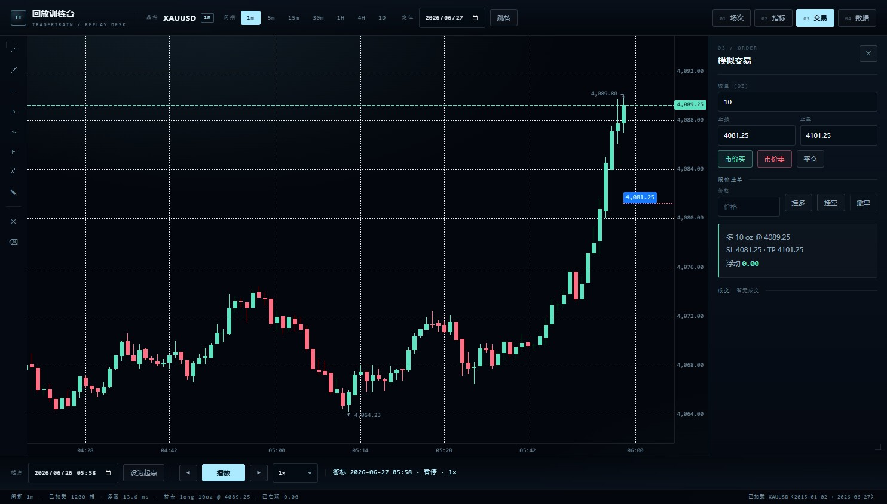

# TraderTrain

本地、离线、自用的 **K 线回放 / 模拟交易 / 复盘** 工具。原生 ESM 静态页 + `start.bat`，无构建链、不联网、数据只进本机 IndexedDB。



## 快速开始

前提：Windows + Chrome + Python 3（`tools/serve.py` 只用标准库）。

```bash
git clone git@github.com:sgzlin5/TraderTrain.git
cd TraderTrain
start.bat            # 起服务（固定端口 8731）+ 用独立 profile 打开 Chrome --app 窗口
```

首次进来是空的：`04 数据` → 「下载」（Dukascopy 外汇/金属 · Binance 加密）或「导入」（CSV / ZIP）。行情数据不入库，需自己拉一份。

改过代码看不到效果？跑 `restart.bat`（只杀本 app 的 Chrome、清 4 个缓存目录，**不动 IndexedDB 行情**）。窗口本身也有版本看门狗，会提示「发现新版本」。

## 功能

| 模块 | 已实现 |
|---|---|
| 行情 | Dukascopy + Binance 下载（加密 7×24、外汇跳周末）、CSV / ZIP 导入（含 ZIP64）、二进制存储 28 B/根、增量追加不覆盖 |
| 回放 | 逐根前进/回退、0.25×–16×、随机起点、多图分屏、每格独立品种与周期、十字光标跨图同步 |
| 绘图 | 20+ 工具（趋势/射线/斐波那契/通道/涂鸦…）、每工具独立样式模板、绘图管理（多选删除/清空周期）、按 品种×周期 持久化 |
| 指标 | 内置指标库（分类 / 收藏 / 组合模板 / 星级 / 关键位 / SMC / 订单流）+ Pine Script 运行时（PineTS）：参数面板（`options` 出下拉）、绘图对象、表格、`alert()` 提醒面板、`strategy` 回测统计 |
| 交易 | 模拟下单（市价/限价）、止损止盈、持仓与成交、按盎司计 PnL |
| 复盘 | 场次统计、复盘档案、报告打印（另存 PDF）、备注 |
| 界面 | 5 套主题（含色盲友好）、顶栏两行、悬浮/竖排工具栏、迷你布局示意图、TAB 多工作区、截屏到剪贴板 |

## 交互速查

- **顶栏两行**：第一行品种/周期/`01 场次`–`04 数据`；第二行「图表操作」= 保存 · 布局 · 指标库 · 主题。
- **TAB**：`＋` 新建；改名四个入口——双击名字 / 点已激活 TAB 的名字 / 右键菜单 / `F2`；右键还有「关闭这个图表」「新建图表」。
- **右键图表**：二级菜单（布局、复制绘制、重置视图、复制图片…）；`Esc` 逐层关面板。
- **布局**：下拉里是迷你示意图（分屏 1–4 格 + 副图数量），不是文字。
- **快捷键**：`空格` 播放/暂停、`→/←` 单根、`R` 回起点、`Esc` 取消绘制。

绘图样式表、数据格式、图标生成、面板行为等细节见 **[docs/MANUAL.md](docs/MANUAL.md)**。

## 自检

```
app/index.html?selftest=1 … 37      # 36 项，浏览器里跑，结果写 window.__RESULT__
bash tools/check_js.sh              # 72 个模块语法检查
node tools/check_refs.mjs           # 未定义引用扫描
```

## 目录

```
app/          index.html · styles.css · src/*.js（原生 ESM）· vendor/（klinecharts、PineTS）
tools/        serve.py（静态服务 + 下载/导入 API）· csv2bin.py · make_manifest.py · 体检脚本
docs/         MANUAL.md（手册）· ACCEPTANCE.md（验收）· BACKLOG.md（计划）· 截图
data/         manifest.json（行情清单一览；bin/ 不入库）
```

## 文档

| 文件 | 内容 |
|---|---|
| [docs/MANUAL.md](docs/MANUAL.md) | 使用手册（全部细节） |
| [docs/ACCEPTANCE.md](docs/ACCEPTANCE.md) | 验收记录与判据 |
| [docs/BACKLOG.md](docs/BACKLOG.md) | 待办与已砍项 |
| [docs/PINE-SUPPORT.md](docs/PINE-SUPPORT.md) | Pine 支持范围 |
| [docs/VELA-FEASIBILITY.md](docs/VELA-FEASIBILITY.md) | 换 Vela 图表的可行性评估（实测包体/耗时） |
| [docs/VELA-MIGRATION.md](docs/VELA-MIGRATION.md) | klinecharts → Vela 迁移方案（分支 `vela`） |
| [docs/UI-AUDIT-2026-11-03.md](docs/UI-AUDIT-2026-11-03.md) | 界面审计项 |

## 已知限制（摘要）

- Pine 只支持 `indicator()`；`request.security` 返回 null、`barstate.isconfirmed` 恒 false，计算范围是当前窗口 1200–1280 根。
- XAUUSD 源数据 `volume` 全 0，成交量面板无数值（顶栏挂「无成交量」标注）。
- 单次导入上限 1 GB；总量受浏览器配额限制（本机实测 10,309 MB）。
- 2023 年数据偏薄（308,752 根 vs 常规 353k），该区间不宜做精确统计。

完整清单见 [docs/MANUAL.md](docs/MANUAL.md) 第 23 节。

## 许可

本项目代码 Apache-2.0（见 `LICENSE`）。第三方：klinecharts（Apache-2.0）、PineTS（**AGPL-3.0**，见 `NOTICE.md`）。仓库不含行情数据。
