# TraderTrain 使用手册

> 这里是全部细节；[README](../README.md) 只保留上手最短路径。

## 目录

1. [界面](#1-界面)
2. [顶部两行布局](#2-顶部两行布局)
3. [Tab 改名（四个入口）](#3-tab-改名四个入口)
4. [布局菜单用示意图](#4-布局菜单用示意图)
5. [面板关闭](#5-面板关闭)
6. [看不到新版本 / 关不掉浮层？](#6-看不到新版本--关不掉浮层)
7. [快捷键](#7-快捷键)
8. [截屏当前窗口 → 剪贴板](#8-截屏当前窗口--剪贴板)
9. [十字光标跨图同步](#9-十字光标跨图同步)
10. [多品种同屏](#10-多品种同屏)
11. [场次（复盘）](#11-场次复盘)
12. [复盘报告（打印 / 另存 PDF）](#12-复盘报告打印--另存-pdf)
13. [自编指标（Pine Script）](#13-自编指标pine-script)
14. [Pine 在 Worker 里跑](#14-pine-在-worker-里跑)
15. [策略回测（Pine `strategy`）](#15-策略回测pine-strategy)
16. [脚本提醒（Pine `alert()`）](#16-脚本提醒pine-alert)
17. [绘图管理](#17-绘图管理)
18. [历史数据下载（页面内，Dukascopy + Binance 合并列表）](#18-历史数据下载页面内dukascopy--binance-合并列表)
19. [从 ZIP / CSV 导入（本地文件）](#19-从-zip--csv-导入本地文件)
20. [数据格式（28 B/根，小端）](#20-数据格式28-b根小端)
21. [重新生成数据](#21-重新生成数据)
22. [图标与桌面快捷方式](#22-图标与桌面快捷方式)
23. [已知限制](#23-已知限制)
24. [其它](#24-其它)
25. [设计规则参考（financial-ui-suite）](#25-设计规则参考financial-ui-suite)

## 1. 界面

标题栏与左上角是 **TraderTrain**，标语「复盘行情，沉淀判断。」为彩虹流光字（渐变横扫，7 s 一轮）。配色与排版参考溯刻 RE:TICK（近黑深蓝底 + 发丝线 + 等宽小标签 + 青冰色强调）：

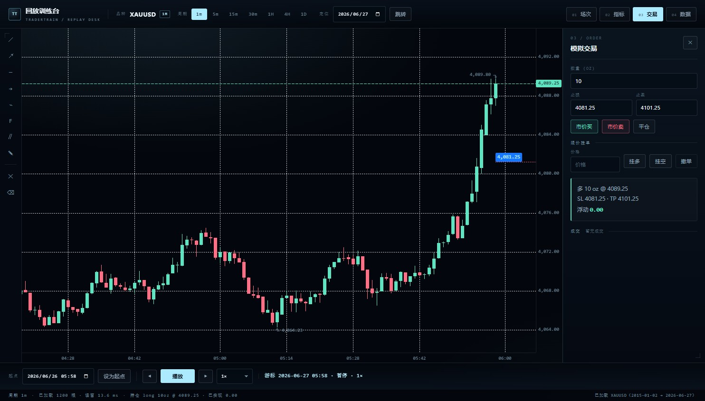

- 顶栏：字标 · 品种 · 周期段控 · 日期定位 · 右侧 **保存**（软盘，红点=有改动）/ **布局**（分屏 + 副图）/ **指标**（数量徽标）/ **主题**（下拉：墨蓝·雾白·晴空·暖砂）/ `01 场次 / 02 复盘档案 / 03 交易 / 04 数据`
- 主题：**四套**（墨蓝 / 雾白 / 晴空 / 暖砂），下拉点选即换并记住（图表配色、网格、坐标轴一起换；你在版面设置里改过的涨跌色不会被覆盖）
- **图表 TAB**（顶栏下的一条）：`＋` 或「新增图表」开一个新 TAB，每个 TAB 是**独立的工作区**
  - 各自的周期、独立的分屏布局、**独立的回放游标**——一个走 1m 复盘，另一个挂 15m 看结构，互不干扰
  - 双击 TAB 改名，`✕` 关闭（至少留一个），点 TAB 切换
  - TAB 列表、名称、周期、分屏都会记住，下次启动原样恢复

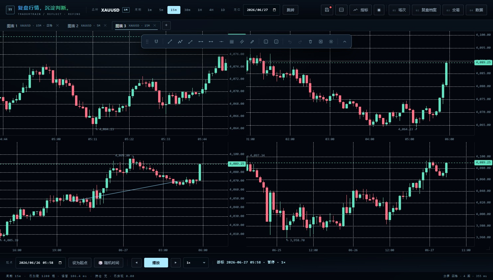

- **多图分屏**（布局按钮）：1 / 2 / 3 / 4 格，共 12 种排布（单图、上下、左右、三行、三列、左一右二、左二右一、上一下二、上二下一、四格、上一下三、上三下一）
  - 每格是**独立的图表实例**，默认周期依次 `1m / 5m / 15m / 1h`，可在格内改周期（点某格 = 激活，周期段控只作用于激活格）
  - 所有格**共享回放游标**：设起点、前进/回退、播放，各格按自己的周期聚合同步推进
  - 绘图按「品种 × 周期」分别存，各格互不干扰；交易与指标作用于激活格
  - 分屏与各格周期都会记住，下次启动照旧

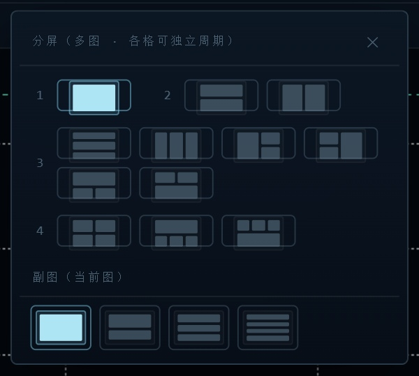

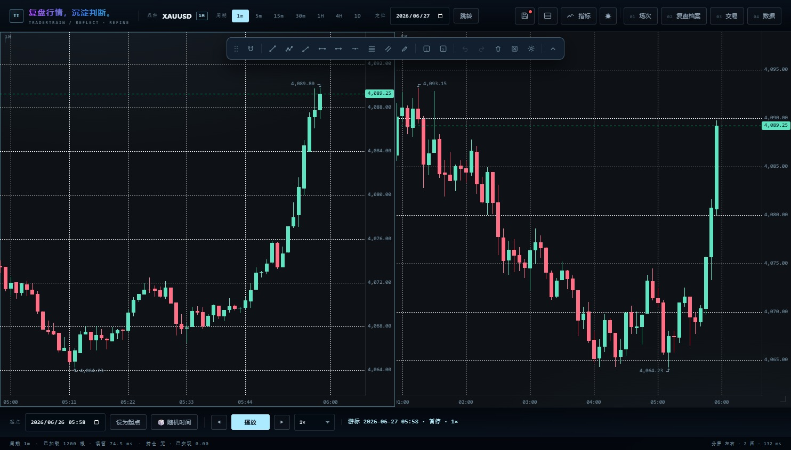

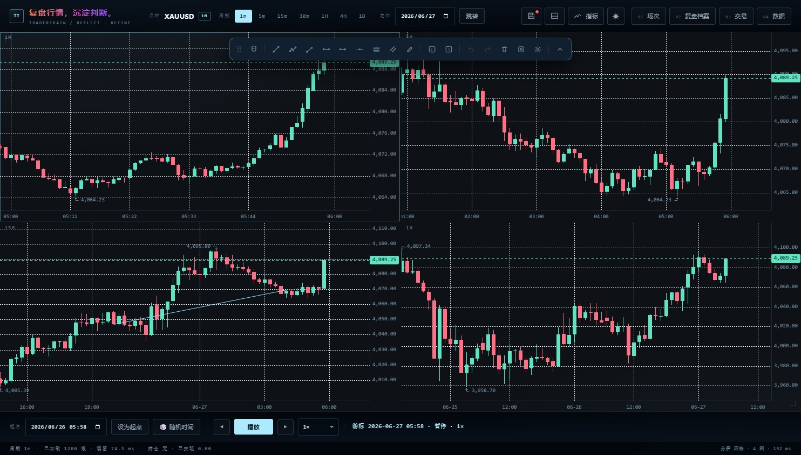

- **绘图工具栏，两种形态**（状态与位置都会记住）：
  - **悬浮**：贴在图表上方的圆角条，左端握把可拖动
  - **左侧竖排**：贴左边缘的 42px 工具列，图表自动让出宽度，按钮多了可滚动
  - 两种形态用工具栏最右/最下的切换按钮互换（`⌃` 收起 ↔ `⇱` 切回悬浮）；原先左下角的「◉ 悬浮工具栏」提示按钮重复，已删除
  - 工具顺序：吸附 → 绘图工具 → 撤销/重做/删除最后一根/清空 → 更多（扩展工具）→ 绘图样式 → 形态切换
  - 画图时控制点是细空心圈（不挡 K 线），选中态略大一点
- 绘制中按右键 = 收尾（折线）或取消（只落了半个点的工具），不会弹图表菜单；不画图时右键照旧是版面设置菜单
- 整个界面都不再弹浏览器原生菜单（输入框/文本域例外），右键只认我们自己的逻辑
- **按住 Ctrl** = 临时吸附（松手恢复；工具栏磁铁是常开开关）
- **按住 Shift** 画趋势线 = 自动水平（两点等高）：按下/松开即时生效，不用再挪鼠标
- 左上角图标是 klinecharts 官方 logo（深色皮肤下自动反色）
- 工具：**吸附**（磁铁）+ **11 个绘图**（趋势线/折线/射线/水平线/水平射线/价格线/斐波那契/平行通道/涂鸦/做多仓位/做空仓位）+ 撤销 / 重做 / 删除最后一根 / 清空 + **绘图样式**（齿轮）
- 底部：回放条（起点 / ◀ 播放 ▶ / 速度 / 游标读数）+ 等宽状态栏
- 右侧抽屉：`docs/ui-session.jpg`（场次统计）、`docs/ui-data.jpg`（数据管理）
- 图表主题在 `app/src/chart.js` 的 `THEME` 里，与 CSS token 对应（涨 `#5fe3c0` / 跌 `#ff6f85` / 强调 `#aceaff`）
- **右键图表 → 二级菜单**
  - 复位图表（回到最新一根 + 恢复默认柱宽）
  - 图表设置… ›（二级）：背景（跟随皮肤 / 自定义）、网格开关与颜色、上涨·下跌颜色、上涨·下跌边框（可「跟随涨跌」）、恢复默认；改动即时生效，自动存 IndexedDB `layout:chart`
  - 复制此图表（写剪贴板，不行则下载 JPG）
  - 从其他图复制绘制 ›（二级）：列出其他周期里已有的绘图，点一下把落在当前数据范围内的图形复制到本图

### 布局 / 指标 / 主题

- **布局**：下拉选择单图 / 双图 / 三图 / 四图（主图 + 0~3 个副图面板，自动补 MACD·RSI·KDJ 并分配高度）
- **指标**：打开指标库 —— 分类（全部 / 主图 / 副图 / Pine 自编）、搜索、已上图列表、27 个内置指标一键添加/移除，按钮上的数字是当前已上图数量；「新建 Pine 指标」进入 Pine 编辑器
- **主题**：☀/☾ 一键切换亮暗

### 选中绘图（浮动操作条）

在图上点一条已画的线/图形，图上浮出操作条：**名称 · 颜色 · 线宽（0.8–3px） · ⋯ · ⚙ · 🗑**

- 颜色/线宽：只改**这一条**，立刻生效并保存（每条绘图自带 `lineStyle`）
- `⋯`：线型（实线/虚线/点线）、**模板**（保存/应用/默认）、斐波那契层级…、恢复内置默认
- `⚙`：打开该工具的全局默认样式（新画的图用这套）
- `🗑`：删除这一条（可撤销）
- 点空白处 / Esc 收起；选中状态下线端点和端点圆点会高亮

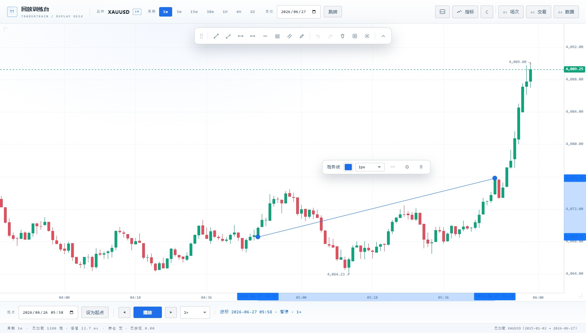

#### 样式模板

每个绘图工具都能存多套样式模板（颜色 + 线宽 + 线型，斐波那契还带层级）：

- `⋯ → ＋ 保存为模板…`：把当前这条的样式存成命名模板，并设为该工具的默认
- 菜单里直接列出该工具已有模板，点一下 = **应用到当前图形 + 设为默认**；右侧 `×` 删除
- `⋯ → ↺ 应用默认模板`：把该图形的样式恢复成工具默认模板
- 之后新画的同类图形自动套用默认模板
- 存在 `ui:drawTemplates`，重开仍在

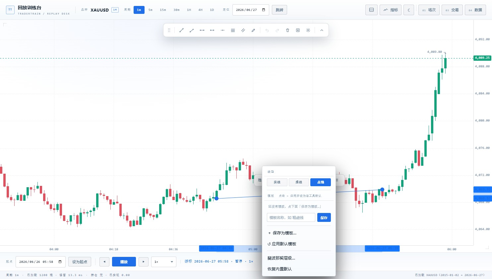

#### 做多 / 做空仓位（盈亏比）

工具栏末尾两个 `L` `S` 按钮：连点三次 —— **入场 → 止损 → 止盈**。

- 自动画出：入场实线、止损/止盈虚线、风险区（红）、收益区（绿），区域一直延伸到右边界
- 图上标注：`做多 4,065.05` / `SL 4,068.99 -0.07%` / `TP 4,072.15 +0.15%` / `盈亏比 1 : 2.07`
- 画完可拖三个控制点改价；选中后能改入场线颜色与线宽（止损/止盈保持语义色），也能存成样式模板
- 和普通绘图一样随周期/品种落盘，重开仍在

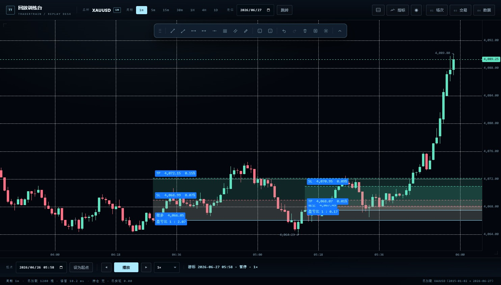

#### 指标库（分类 / 收藏 / 组合模板）

顶栏「指标」打开右侧面板，结构照参考站点：

```
INDICATOR LIBRARY                    ✕
指标库
[ 🔍 搜索全部内置指标，如 EMA、均线 ]
当前分类 · 16 个指标              保存当前组合
┌────────┬────────┬────────┬────────┐
│ 我的收藏 │ 组合模板 │ 订单流  │ 关键位 │   ← 选中格琥珀底
├────────┼────────┼────────┼────────┤
│  SMC   │  通用   │ Pine / 自编 │     │
└────────┴────────┴────────┴────────┘
当前目标：主盘 · 1m · 收藏保存在本机浏览器中。

★★★★☆  前日高/低/收 PDH·PDL·PDC        ☆   [ 已添加 ]
         上一交易日高/低/收 · 当天三条参考虚线
★★★★☆  开盘区间 OR                     ☆   [ + 添加 ]
         开盘后 N 分钟高/低 · 突破/回踩观察
```

- **分类**：我的收藏 / 组合模板 / 订单流 / 关键位（自建）/ SMC / 通用（内核 27 个）/ Pine / 自编
- **搜索**：跨全部分类，中文名（`均线`）和英文名（`EMA`）都能搜
- **收藏**：点行尾 ☆，存 `ind:fav`
- **添加/移除**：点 `+ 添加`；已上图显示灰色「已添加」，再点即移除
- **星级**：编辑推荐度（常用好上手，不是回测胜率），口径在 `indicators.js` 的 `RATE`
- **组合模板**：「保存当前组合」把图上一套指标（含参数/颜色）存下来，下次一键应用

##### 自建关键位指标

| 指标 | 说明 | 参数 |
|---|---|---|
| `PDHL` 前日高/低/收 | 上一交易日 H/L/C，在当天画三条虚线 | 离现价 >1.5% 的位不画（避免把纵轴撑爆） |
| `ORB` 开盘区间 | 当天开盘后 N 分钟的最高/最低 | 分钟数，默认 30 |
| `AVWAP` 锚定 VWAP | 日锚定成交量加权均价；无量数据退化均价 | 1=按日，0=按周 |

##### SMC 两个主指标（可视化已重做）

| 指标 | 画什么 | 参数 |
|---|---|---|
| `FVG / IFVG` | 缺口矩形（填补后转 IFVG，反向着色）+ 标签 | 显示个数（默认 8） |
| `Smart Money Concepts (SMC)` · 聪明钱概念 | BOS/CHoCH 虚线 + 标签、订单块矩形、EQH/EQL | 摆动回看（默认 5） |
| `ICT 杀区工具箱` | 四大 Killzone 竖带（ASIA/LONDON/NY AM/NY PM）+ 未填补 FVG | 小时跨度（默认 1） |
| `波段 & 中期结构` | 摆动线（SH/SL）+ BOS/CHoCH + 订单块 | 高周期小时数（默认 1） |
| `Structure & Trend Dashboard` · 结构&趋势面板 | 右下角悬浮面板：三组 HTF/LTF 趋势 + 对齐判定 | 结构周期 / 三组对齐周期 / FVG 上限 / 扫单 / 染色 |

> klinecharts v10 不再调用 indicator 的 `draw` 回调，SMC 这几个指标原来"挂在图上但什么都不画"。
> 现在结构图形改由 overlay 渲染（`smcRender.js`，每 1.2 s 按 payload 同步），面板改由 DOM 渲染；
> 摘掉指标会自动清场（overlay 全删、面板隐藏）。

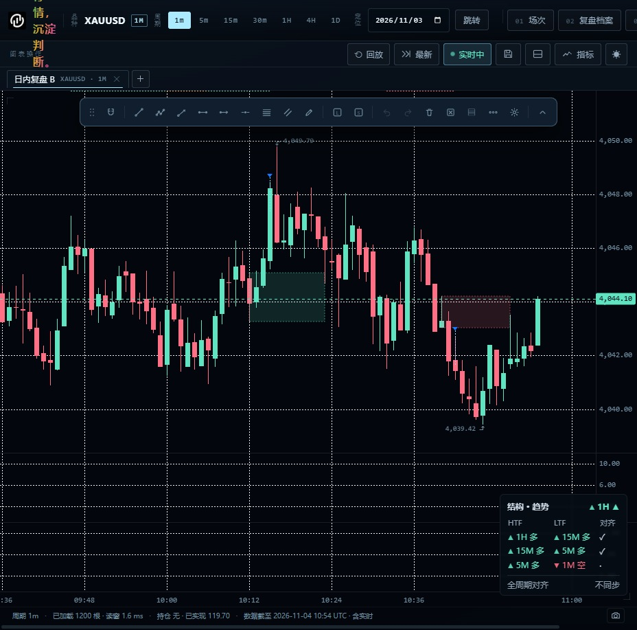

##### 自建均线指标（分类「均线」）

按 LuxAlgo / Pine 口径实现，和 `ta.ema` / `ta.rma` 逐点一致（前 N 根用 SMA 起头，不是“首根就递推”）：

| 指标 | 算法 | 参数 |
|---|---|---|
| `EMA` 指数均线 | `alpha = 2/(N+1)`，SMA 种子 | 周期，默认 `20,50,200`；最多 3 条 |
| `RMA` 怀尔德平滑 | `alpha = 1/N`，SMA 种子（RSI/ATR/DMI 的内核平滑） | 周期，默认 `14,50,200`；最多 3 条 |
| `ZLEMA` 零延迟均线 | `EMA(2×收盘 − 收盘[lag], N)`，`lag=floor((N−1)/2)` | 周期，默认 `20,50,200`；最多 3 条 |

> 这三个都在「均线」分类里，`EMA` 覆盖了内核自带的同指标（同一名字、同一入口，算法换成 Pine 口径）。

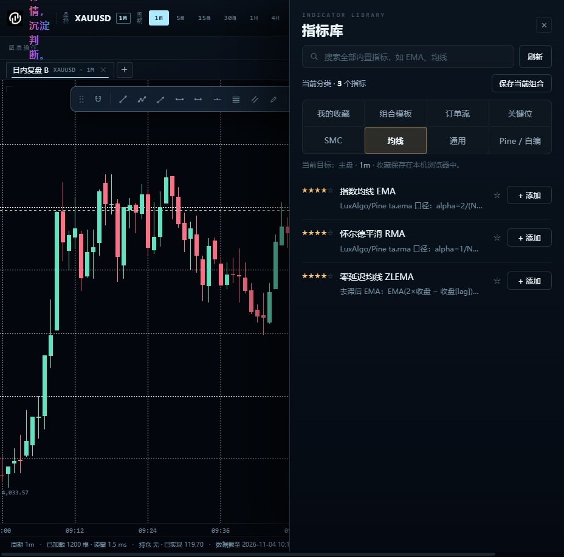

##### 自建通用指标（分类「通用」）

| 指标 | 说明 | 参数 |
|---|---|---|
| `ZLEMA` 零延迟均线 | 去滞后 EMA：`EMA(2×收盘 − 收盘[lag], N)`，`lag=(N−1)/2`。同一周期下拐头比 EMA 早，价格贴着走 | 周期，默认 20；最多 3 条（如 `9,20,50`） |

- 种子用前 N 根的 SMA（与内核 EMA 一致），前 `lag` 根没有参考点就退化成原始收盘价，所以开头不会一大段空白。
- 只设 1 个周期时图例只显示 `ZLEMA1`，不会出现 `ZLEMA2: n/a`（图例已按“有值才显示”过滤）。

##### SMC / ICT 指标

口径参考 TradingView 上 LuxAlgo Smart Money Concepts、ICT Killzones 一类开源脚本，用 K 线 OHLC 自算，不依赖 Pine 运行时。

| 指标 | 画什么 | 参数 |
|---|---|---|
| `SMC_FVG` FVG / IFVG | 三根 K 线之间的缺口（FVG）延伸成区域；被收盘穿越后翻成反向缺口（IFVG） | 保留最近 N 个（默认 8） |
| `SMC_MST` 聪明钱概念 | 摆动结构 + BOS / CHoCH 虚线、突破前最后一根反向 K 线的订单块（OB）、等高/等低（EQH/EQL） | 摆动回看根数（默认 5） |
| `SMC_ICT` ICT 杀区工具箱 | 四大 Killzone 竖带（UTC：亚洲 00–04 / 伦敦 07–10 / 纽约早盘 12:30–15 / 午盘 17:30–20）+ 未填补 FVG | 预留 |
| `SMC_HTF` 波段 & 中期结构 | 把当前数据聚合成 N 小时，画外部结构 BOS/CHoCH、摆动高低位与 HTF 订单块 | 聚合小时数（默认 1） |
| `SMC_DASH` 结构 & 趋势面板 | 结构周期 BOS/CHoCH + **三组周期对齐表**（HTF/LTF/对齐）+ 流动性扫单 + FVG | 摆动 10 / 结构 60 / 三组周期 60·15·15·5·5·1 / FVG 3 / 扫单 1 / 染色 0 |

- `SMC_DASH` 对应 LuxAlgo 的 Structure & Trend Dashboard：结构标签、面板对齐、扫单（SWEEP）、FVG 都在一个指标里；面板固定画在**右下角**（右上被图例占着）。
- 面板两个周期的结构方向：先用摆动结构判定；该周期桶太少时自动缩小回看，仍判不出方向就用 EMA(12/50) 兜底，不会整列都是“震荡”。
- 时间按 **UTC** 解释（`KILLZONES` 常量在 `app/src/smc.js`，改窗口直接改这个数组）。
- 都是主图叠加；离当前视窗很远的结构自动不画，避免糊满屏。
- 图上图例里可单独关/调参/移除。

##### Pine / 自编 分类的界面

指标库 → 「Pine / 自编」按参考站点排版：

```
INDICATOR LIBRARY                    ✕
指标库
[ 🔍 搜索名称或账号 ]          [刷新]
我的指标 · 2 个
┌────────┬────────┬────────┬────────┐
│ 我的收藏 │ 组合模板 │ 订单流 │ 关键位 │
├────────┼────────┼────────┼────────┤
│  SMC   │  通用   │ Pine / 自编 │    │  ← 选中格琥珀底
└────────┴────────┴────────┴────────┘
当前目标：主盘 · 1m · 收藏保存在本机浏览器中。

[        新建 Pine 指标        ]   ← 整行宽按钮

★★★★  Structure & Trend Dashboard          ✎   [ + 添加 ]
      子图 · 14141 字符 · 2026/11/2

从图表移除后仍保留在库中。Pine 脚本只存在本机浏览器里。
ⓘ XAUUSD 当前窗口读取 2015-01-02 → 2026-06-27 的 1 分钟历史，支持切换周期分析与复盘。
```

- 空库时显示居中卡片：**编译一次，随时取用** + 说明。
- 行内 `✎` 直接在编辑器里打开该脚本（脚本名/源码/参数一起带过去）。
- 这个分类不显示「保存当前组合」（那是数值指标组合的功能）。

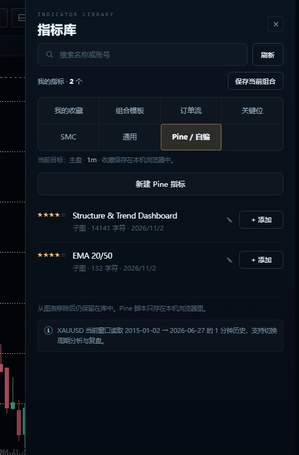
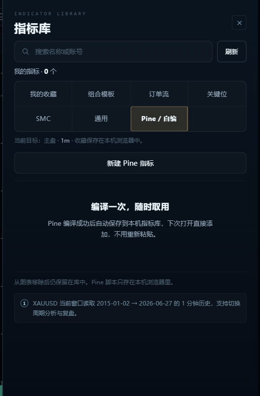

##### Pine v5 / v6 支持范围

执行器是 PineTS（v5 运行时，**能识别并解析 v6 语法**，`ctx.pineVersion` 实测为 6）。已验证可跑：

| 语法 | v6 实测 |
|---|---|
| `switch` / `for` / `while` / `var` / `varip` | ✓ |
| `array.*` / `ta.*`（ema / sma / rsi / atr / stoch / crossover / pivothigh / pivotlow / valuewhen…） | ✓ |
| `hline()` | ✓（按常量序列画） |
| `input.int/float/bool/string/source/color` | ✓（面板按类型给控件） |
| `plotshape` / `plotchar` | 只画数值，没有形状样式 |
| `bgcolor` / `barcolor` / `fill` | 不渲染（也已从输出里过滤，避免出现噪声线） |
| `table.*` / `label.*` / `box.*` / `line.*` | ✅ 渲染（表格走 DOM 面板，线/框/标签画在 canvas 上） |
| `request.security` 同品种多周期 | ✅ 可用（运行时内部聚合） |
| `strategy.*` / 跨品种 `request.security` | 不执行 / 返回 null |

点「检查代码」会先跑兼容性预检，把命中的问题直接列出来，例如：

```
编译通过：0 条输出 · 主图
请注意：这次没有任何数值输出，图上不会出现线
脚本声明 v6：语法已按 v6 解析（switch / array / pivothigh / valuewhen / hline 都验过）；
不支持的是绘图对象（table / label / box / line）与 strategy。
✕ table.* 表格绘制不会被渲染（面板类脚本常见）
✕ label.* 文字标注不会被渲染
✕ 脚本里没有 plot()：数值型输出才算指标，label/table/box 画的东西不会上图
```

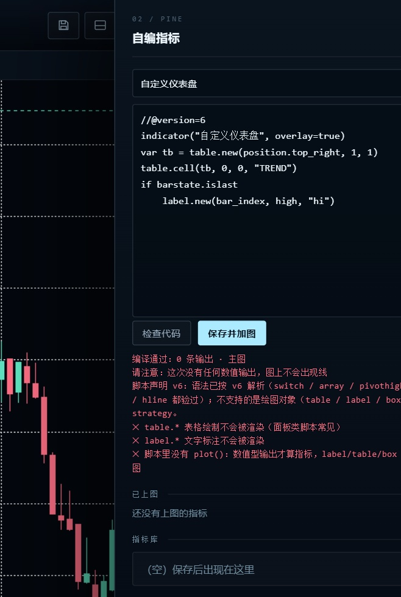

##### Pine 自编指标的参数面板

打开图上图例的 ⚙，Pine 指标会列出**脚本里声明的全部 input**，按类型给不同控件：

| 声明 | 控件 |
|---|---|
| `input.int(14, title="周期", minval=1, maxval=200)` | 数字框（带 min/max/step，右侧显示范围） |
| `input.float(2.0, title="倍数", step=0.5)` | 数字框（小数） |
| `input.bool(true, title="使用中值")` | 勾选框 |
| `input.source(close, title="价格源")` | 下拉：open / high / low / close / hl2 / hlc3 / ohlc4 |
| `input.string("x", "标题")` | 文本框 |
| `input.string(..., options=["A","B"])` | **下拉选择**（如 Position / Size） |
| `input.timeframe("", "结构周期")` | 文本框（占位 `5 / 15 / 60 / 240 / D`，留空=当前周期） |
| `input.color(color.red, "标题")` | 取色器 |

- 线条区按 `plot()` 顺序列出每条序列（basis / upper / lower…），可单独改颜色、线宽、线型、显隐。
- 「应用」= 存进脚本条目 → 重算 → 重新挂图；**参数与线条都会跟着脚本保存**，下次打开还在。
- 「恢复默认」= 清掉已保存的 inputs 与线条，回到源码里的默认值。
- 支持 `title=`、`minval=`、`maxval=`、`step=`、`defval=`、`tooltip=` 与位置参数两种写法。
- **指标名 = 你保存的脚本名**（如 `Candle 2 Closure [LuxAlgo]`），图例、设置面板标题都用它；内部仍用 `PINE_<hash>` 做实例名。
- **刷新页面后会自动把上次上图的 Pine 指标重新算好挂回来**（`pine:active` + `pine:map` 记在 IndexedDB），设置面板也照样能开。

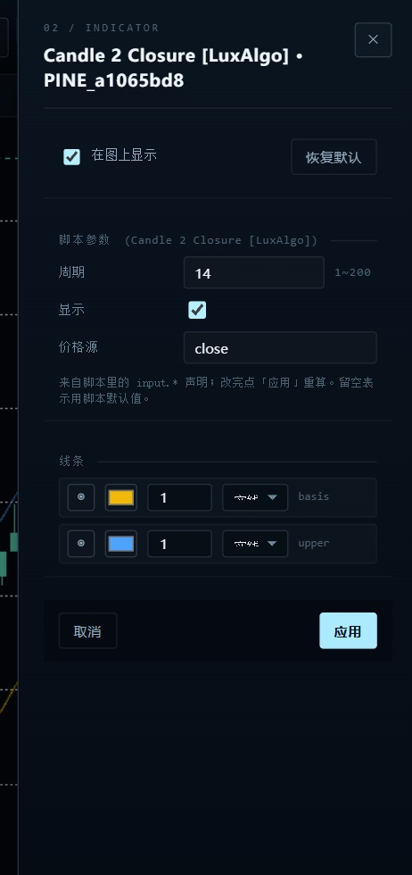

##### 订单流（成交量 / 综合 VP / 订单墙 / 挂单深度）

本应用只有 OHLCV（没有逐笔、没有 L2 盘口），所以这四个指标都做了**口径降级**，界面上会明确标出用的是哪种口径：

| 指标 | 有成交量时 | 无量数据源（如 XAUUSD） | 参数 |
|---|---|---|---|
| **成交量** | 按周期画涨/跌量柱（副图） | 副图里给一行提示，不画假柱 | — |
| **综合 VP** | 按成交量做价格分布，算 POC / VAH / VAL（70% 价值区） | 退化成**价格停留时间**分布，标签显示 `VP·TIME` | 回溯根数，默认 600 |
| **订单墙** | 成交量 ≥ N 倍中位数的柱子标 `WALL ×倍数` | 退化成**同价反复触及**的流动性簇，标 `WALL ×n 触及` | 倍数，默认 4 |
| **挂单深度** | 每个价位的买卖成交量差，画成右缘梯子 | 退化成**涨/跌 K 线数量差**，标签显示 `DEPTH·时间差` | 回溯根数，默认 120 |

- 真实挂单墙/盘口深度需要逐笔与 L2 数据，这里不编造盘口数字；要看真实深度得接交易所 L2 接口（后续可加）。
- 综合 VP 与挂单深度都贴图表右缘，同时开时自动错开（VP 在最右，深度让出 118px）。
- 标签都带底色，压在 K 线上也看得清。


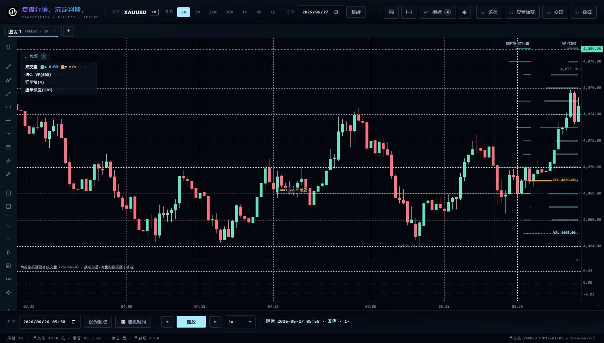

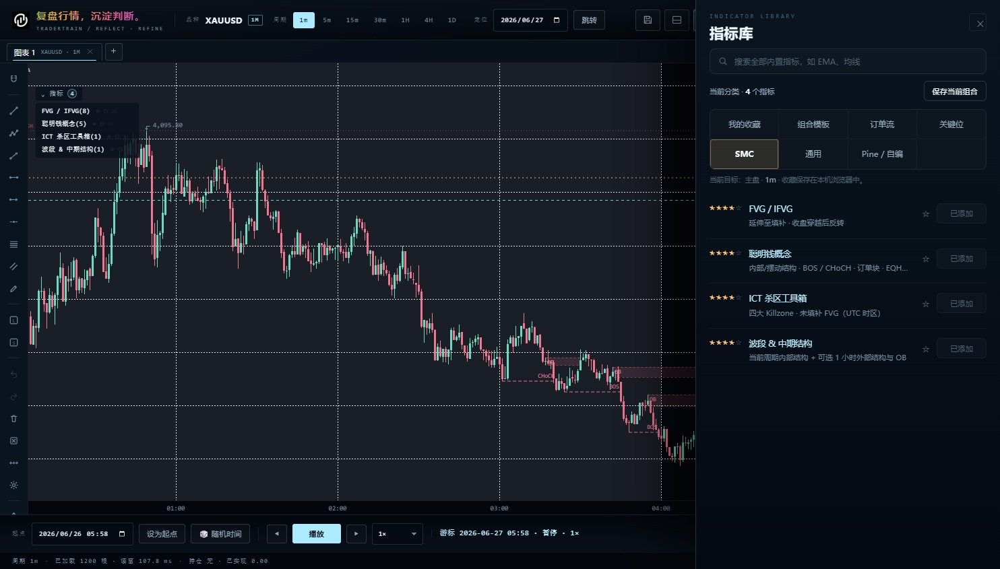
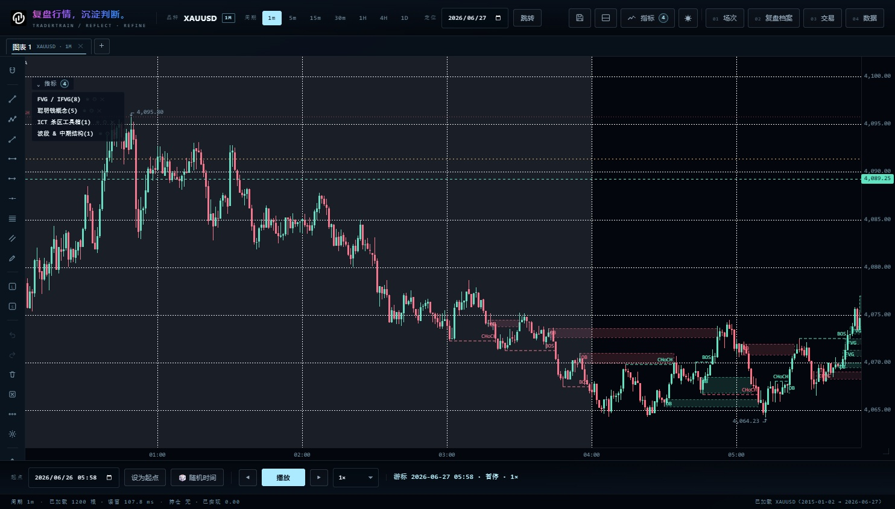


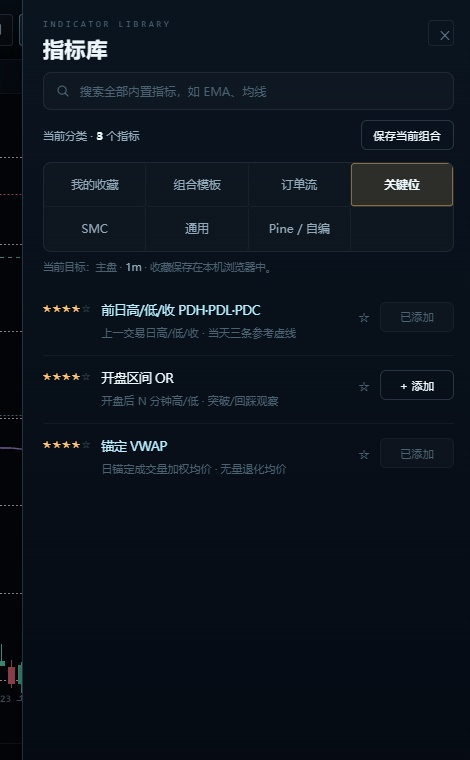

#### 扩展工具（@klinecharts/extension 0.1.0）

工具栏 `⋯` 打开「扩展工具」，共 **18 个**官方扩展绘图，官方包原样集成在 `app/vendor/klinecharts-extension/`：

| 类别 | 工具 |
|---|---|
| 分析 | 测量、江恩箱 |
| 斐波那契 | 扩展、段、圆、速阻扇形、螺旋 |
| 形态 | AB=CD、蝴蝶 XABCD |
| 波浪 | 三浪、五浪、八浪、任意浪 |
| 基本图形 | 箭头、矩形、圆、三角、平行四边形 |

- 用法和其他绘图一样：点工具 → 图上落点 → `onDrawEnd` 自动落盘，可拖点、可改线型、能随「品种 × 周期」重建
- 每个工具需要几个点由它自己的模板决定（测量 2 点、斐波那契扩展 3 点…），图上会有提示点
- 集成方式：官方包是 ESM + 裸模块名 `klinecharts` 依赖；本项目是 UMD 全局，所以加了一层 `klinecharts-shim.js` 把 `utils` 从 `window.klinecharts` 转出去，无需打包器

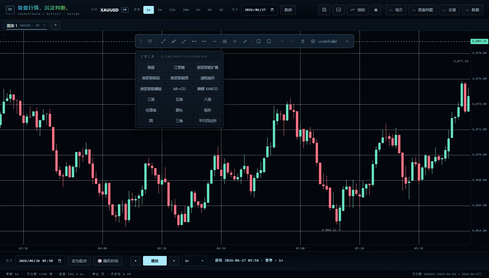

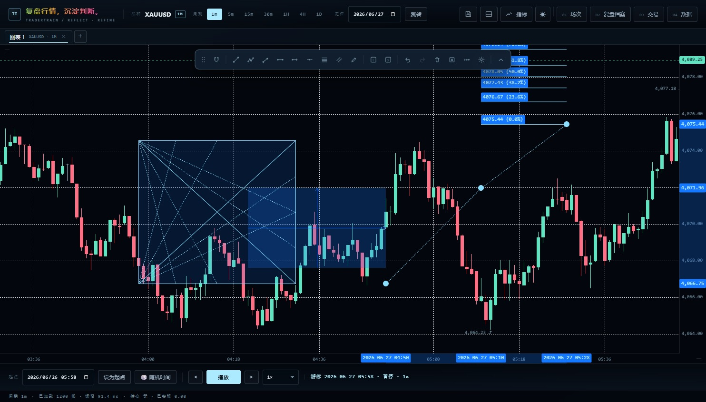

#### 折线

工具栏第 3 个按钮（锯齿线图标）：

- **多次点击**连续落点，**双击 / 右键 / 回车**结束，**Esc** 取消（不足 2 点自动丢弃）
- 画完可拖任一顶点改位置；颜色/线宽/线型随「绘图样式」和模板走

#### 吸附（磁铁）

工具栏最前面的磁铁按钮，开关状态存在 `ui:magnet`：

- **开**：落点自动吸到最近 bar 的 **开/高/低/收**（按像素距离挑最近的那个），同时把 x 对齐到该 bar
- 折线是落点即吸附；其它工具在**画完/拖完**时对齐一次
- **关**：落点保持你点的任意价位

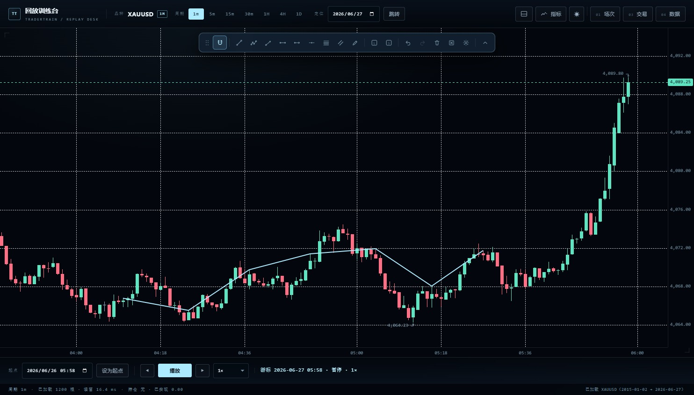

#### 复盘档案（顶栏「02 复盘档案」）

每做完一轮就有一份档案，顶栏「复盘档案」打开档案库：

- **列表**：名称 · 标签 · 品种 · 周期 · 日期 · 笔数 · 净盈亏 · 评分
- **筛选**：按品种、进行中/已结束；**搜索**名称/标签/结论；**排序**：时间、净盈亏、笔数、评分
- **点开一行**：看这轮的绩效（净盈亏/胜率/盈亏比/期望/回撤/收官权益）+ 最近几笔，并给这轮**打标签、评分、写结论**（存进档案）
- **打开**：把图表切回这轮的**周期和回放起点**，并载入这轮的交易，重新走一遍
- **导出**：单份 JSON / 汇总「导出全部」；**删除**：连点两次确认

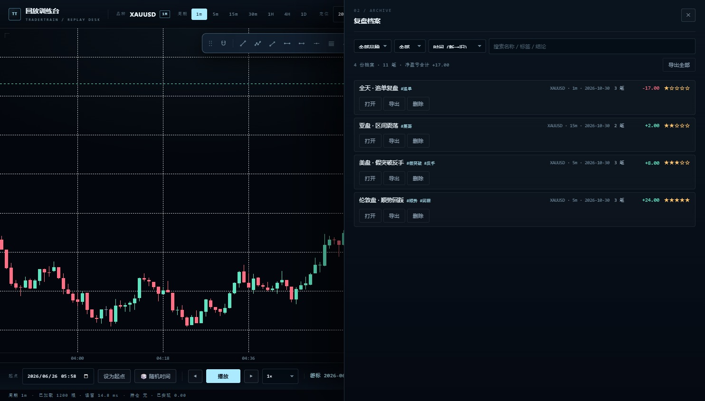

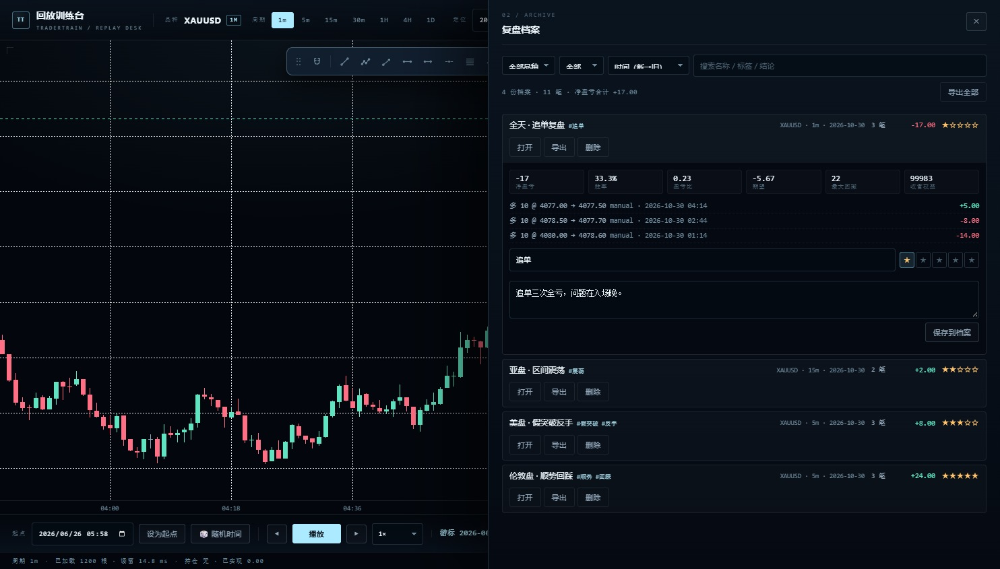

#### 配置存档（顶栏保存按钮）

顶栏软盘按钮把当前工作区配置写成一份本地存档 `cfg:workspace`：

- **存什么**：品种、周期、回放起点、主题、右键版面设置、吸附开关、绘图样式、绘图模板、工具栏位置/形态
- **有改动**时按钮右上角亮红点；点一下（或 `Ctrl+S`）保存，红点消失，状态栏报时间
- **下次启动**按存档恢复——保存后再乱改，刷新会回到存档那一版
- 没点过保存的话，各项仍走原有的自动持久化（`ui:theme`、`layout:chart` 等），行为不变


#### 随机起点

底部回放条的 **🎲 随机时间**：在整段数据里随机取一个回放起点（首尾各留一天，避免贴着边界）。

- 落点若在周末/缺口里，自动顺延到下一根真实 1m bar，不会卡在空档
- 同时更新「起点」输入框与游标显示
- 快捷键 `Shift+R`（`R` 仍是按输入框设起点）


#### 主题

顶栏最右边的 ☀/☾ 按钮打开主题列表，四套可选，点一下即换，存 `ui:theme`：

| 主题 | 底子 | 涨跌色 |
|---|---|---|
| 墨蓝 | 近黑深蓝 | 冰青 / 珊瑚红 |
| 雾白 | 浅灰白 | 墨绿 / 砖红 |
| 晴空 | 浅天蓝 | 青蓝 / 珊瑚红 |
| 暖砂 | 浅橙米 | 琥珀 / 黛蓝 |

- 换主题时，**你没手动改过的**涨跌色会跟着主题走；右键「版面设置」里自定义过的颜色不动。
- 图表（K 线、网格、坐标轴、十字光标、指标线）与界面控件同时换，截图底色也跟着换。

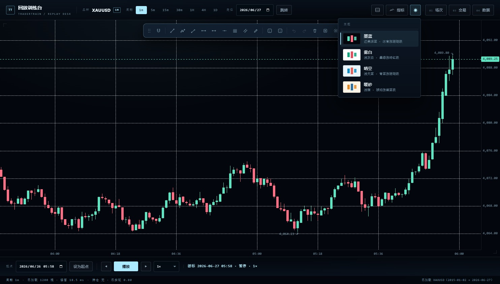

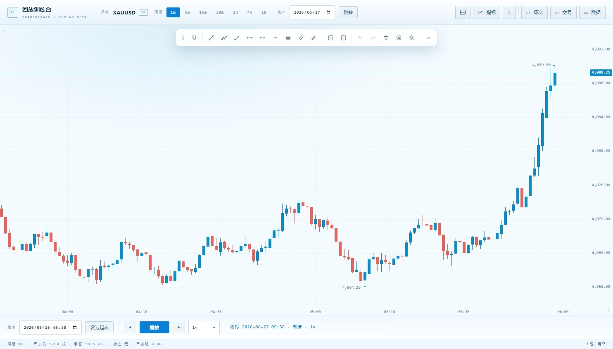

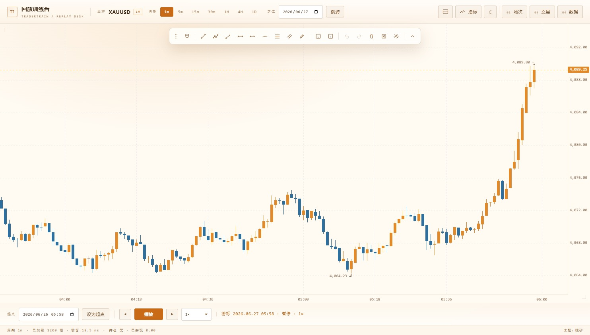

### 绘图样式（工具默认值）

工具栏齿轮 → 「绘图样式」：

- 每个工具可单独设 **颜色 / 线型（实线·虚线·点线）/ 粗细（1–4px）**，`⟲` 恢复该工具默认
- 颜色留空 = 跟随主题强调色（亮暗切换自动变）
- **斐波那契层级可增删**：默认 `100 / 78.6 / 61.8 / 50 / 38.2 / 23.6 / 0%`，输入框加任意值（`0.705` 或 `70.5` 都行），预置「标准 / 扩展 / 密集」三套
- 改完立刻重画已有绘图，设置存 `ui:drawStyles`

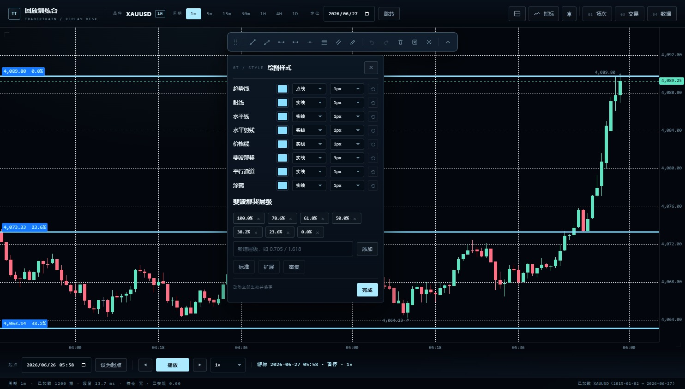

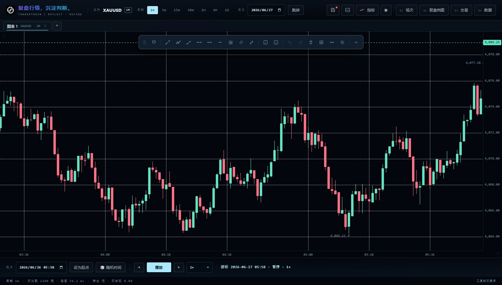

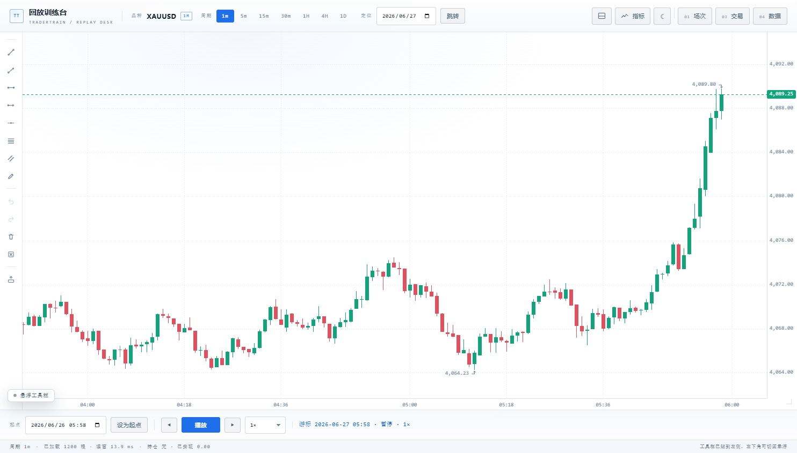

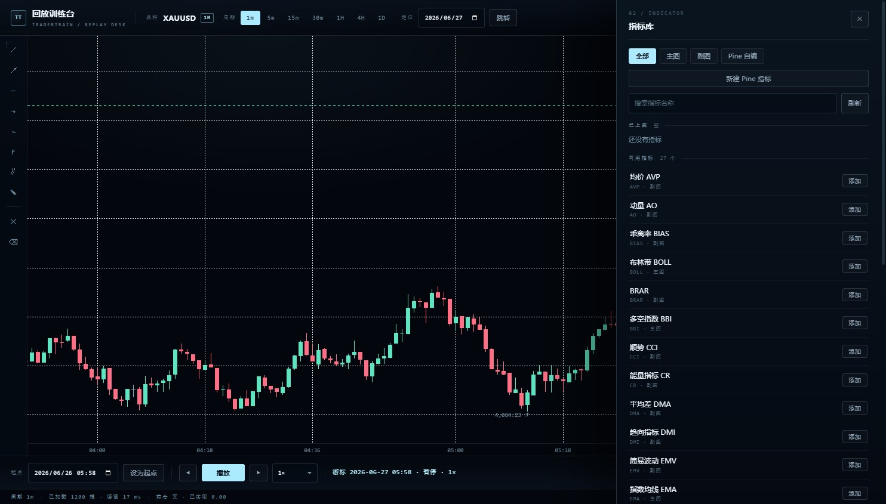


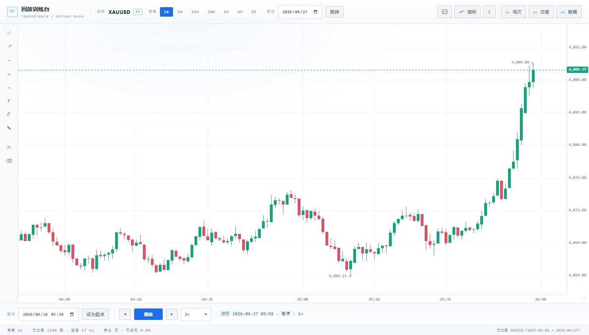

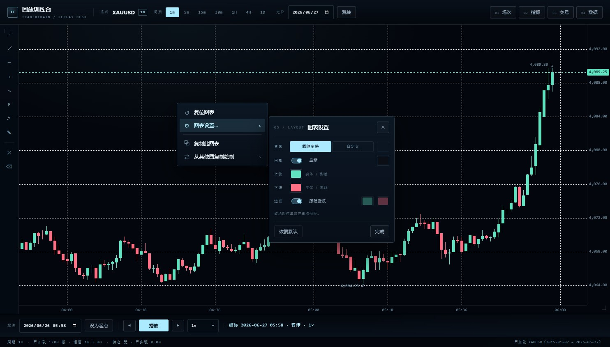

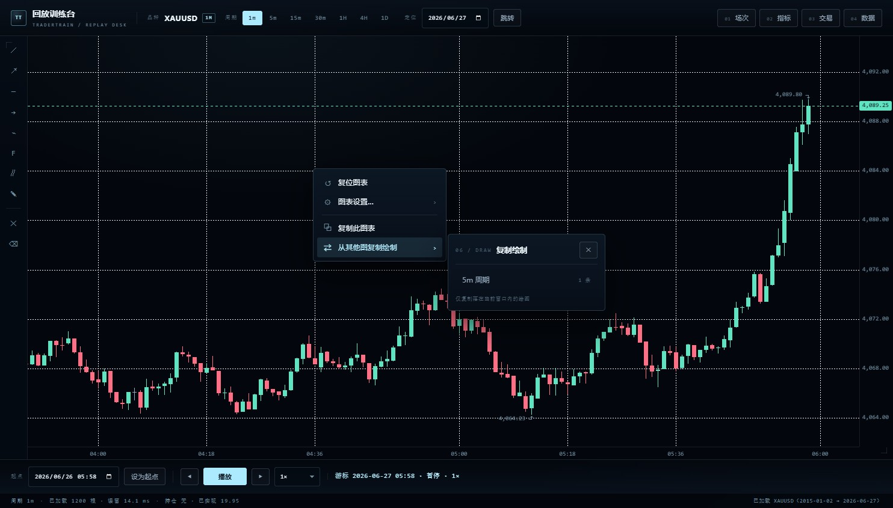

### 布局浮层怎么关

四条路都行：**标题右上的 ✕**、**点图表任意位置**、**再点一次「布局」按钮**、**Esc**；选完某个布局会自动收起。

## 2. 顶部两行布局

- 第 1 行：品牌 / 品种 / 周期 / 定位 + `01 场次`、`02 复盘档案`、`03 交易`、`04 数据`。
- 第 2 行（`#topbar2`）：左侧 `图表操作` 标签，右侧 **保存配置 / 布局 / 指标库 / 主题** 四个图标按钮。
- 第 3 行是图表 TAG 条，再往下是图表区。

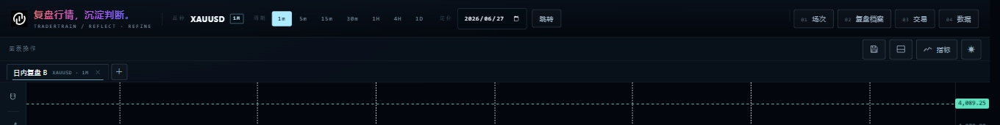

## 3. Tab 改名（四个入口）

- **双击 tab 名称**就地编辑；
- **点已激活 tab 的名字**（像资源管理器那样）直接进入改名；
- **右键 tab** → 重命名（菜单里还有「关闭这个图表」「新建图表」）；
- 键盘聚焦 tab 后按 **F2**（`Enter` 也可以；`Delete` 关闭）。

`Enter` 或点别处保存，`Esc` 取消；空白名不覆盖原名，超 20 字截断。

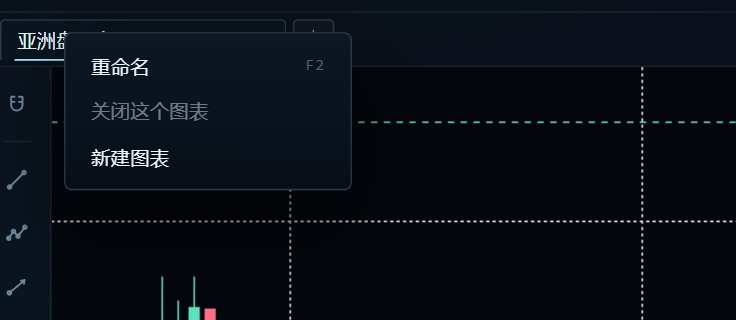
- 名字存进 `ui:tabs`，重开窗口仍在；副标题（品种 · 周期）不受影响。
- 编辑中直接点 tab 上的 `✕` 也能关掉这个图（关闭走 `mousedown`，避免输入框失焦重渲染把点击吃掉）。

## 4. 布局菜单用示意图

布局菜单不再写「单图 / 上下 / 左右 / 左一右二」这些文字，改成按格子数分组的迷你示意图：

- 左侧小数字 `1 / 2 / 3 / 4` 是格子数，右边是同格子数的各种排布。
- 每个示意图直接用布局自己的 `grid-template-columns/rows` + `grid-area` 画，**看到的就是切换后的样子**，不会出现“图和布局对不上”。
- 下面「副图（当前图）」同理：1 个主格 + N 个副格，一眼看出是主图 + 几个副图。

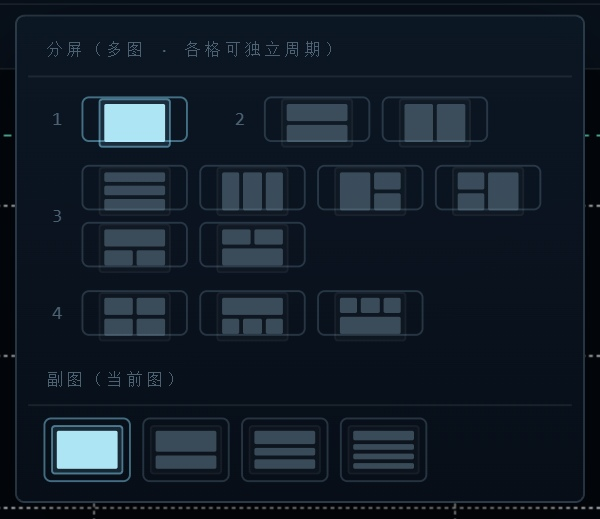

## 5. 面板关闭

所有抽屉/浮层都能用三条路关掉：**✕ 按钮**、**Esc**、**再次点同一按钮**。
Esc 的关闭顺序是最上层优先：指标设置 → 指标库 → Pine 编辑器 → 扩展工具 → 复制绘制 → 右键菜单 → 布局 → 主题 → 复盘档案；画图进行中时 Esc 仍然是「取消这一笔」。

## 6. 看不到新版本 / 关不掉浮层？

窗口跑的是内存里的旧页面时，改了代码也不会自动生效。现在有两道保险：

1. **版本看门狗**：页面每 45 秒（以及切回窗口时）拉一次 `index.html` 的构建号，发现新版本就在顶部弹提示条
   `发现新版本，当前窗口还在跑旧代码 [立即刷新] [稍后]`；切走再切回来会直接静默刷新。
2. **`restart.bat`**：关掉本 app 的窗口 → 清 `Cache / Code Cache / GPUCache / Service Worker`
   （**不动 IndexedDB 行情数据**）→ 重新 `start.bat`。窗口已经卡在旧代码上时用它。


### 设计令牌

- **字号**：`--fs-2xs:10 / --fs-xs:11 / --fs-sm:12 / --fs-md:13 / --fs-lg:14 / --fs-xl:16 / --fs-2xl:22`，样式表里不再写裸 px（半像素就近归并）；图表 canvas 上的轴标签/十字光标文字同步 11px（overlay 12px）。改字号只动这 7 个 token。
- **数字**：价格/盈亏/数量一律 `--sans` + `font-variant-numeric: tabular-nums`，跳动不抖位；mono 只留给品种代码、时间戳、指标参数。
- **涨跌**：`.pos` / `.neg` 自带 `▲` / `▼`，不只靠颜色。
- **第 5 套主题「色盲友好」**：墨蓝底 + 蓝涨 `#4fa3ff` / 橙跌 `#ffa14a`，红绿色觉障碍可分；和其余四套一样持久化到 `ui:theme`。

## 7. 快捷键

- 顶部：品种、周期（1m–1D）、日期定位、交易、场次、指标、数据管理
- 左侧：10 个绘图按钮（趋势线/射线/水平线/水平射线/价格线/斐波那契/平行通道/涂鸦 + 删除 + 清空）
- 底部回放条：起点时间、「设为起点」、◀ ▶、播放/暂停、速度 0.25×–16×、游标显示
- 右侧交易面板：数量(oz)、止损/止盈、市价买/卖、平仓、限价挂多/挂空、撤单、持仓与成交列表

| 快捷键 | 作用 |
|---|---|
| 空格 | 播放 / 暂停 |
| → / ← | 前进 / 回退一根 |
| R | 回到起点（按回放条上的时间） |
| Esc | 取消当前绘制 |

绘图按（品种 × 周期）存 IndexedDB；交易记录归到场次（`session.trades`）。
手数单位是盎司：PnL = 价差 × 盎司数。

## 8. 截屏当前窗口 → 剪贴板

状态栏右下角的 **相机按钮**（悬停提示「截屏当前窗口并复制到剪贴板」）：

- 截的是**图表区 + 顶部信息条 + 底部状态条**：顶栏写 `品种 · 周期 · 数据区间`，底栏写 `已加载根数 / 成交笔数` 与当前游标时间，直接粘到聊天窗口就能说明上下文。
- 优先写系统剪贴板（PNG，`Ctrl+V` 可直接粘贴）；浏览器不给权限时自动下载 PNG 并提示。
- 纯前端合成（把 `#chart` 内所有 canvas 按位置拼接），不调用系统截屏权限，也不会弹出授权框。

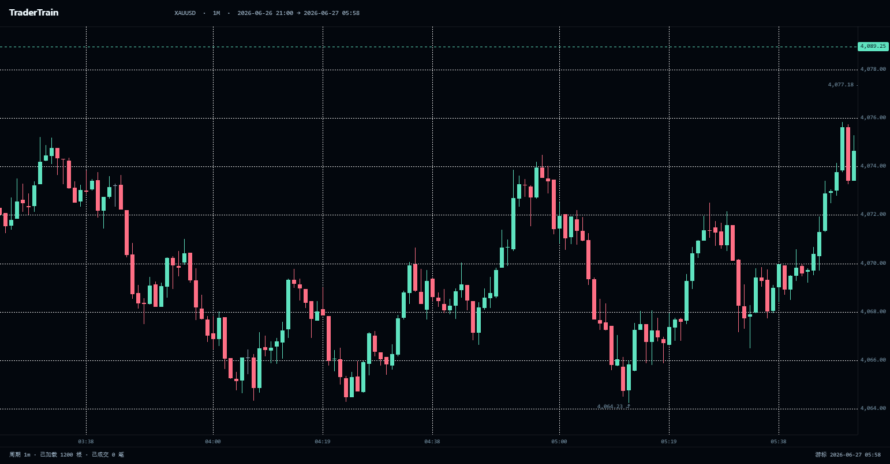

## 9. 十字光标跨图同步

分屏时鼠标在任意一格移动，其余格在同一时间位置显示一条竖线（`crosshairSync.js`）。
klinecharts 10 没有 `setCrosshair`，所以用 `convertFromPixel` 把 x 反解成时间、再用 `convertToPixel` 画到各格；开关在**布局菜单**（`各图十字光标同步`），状态存 `ui:cxsync`。

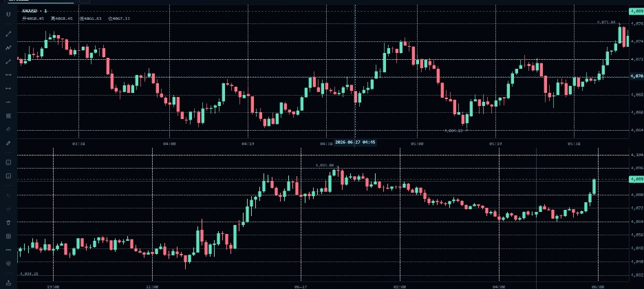

## 10. 多品种同屏

分屏时每一格可以看不同品种：点格子左上角的标签（`XAUUSD · 1M`）→ 选品种。选择随 TAB 持久化，下次打开还是这个组合。

- 换品种会重建该格（保留它的周期），并把游标落到新品种自己的可视区间；
- 顶栏的品种/周期跟着**当前激活格**走；
- 只有一个品种时会提示先去数据面板导入。

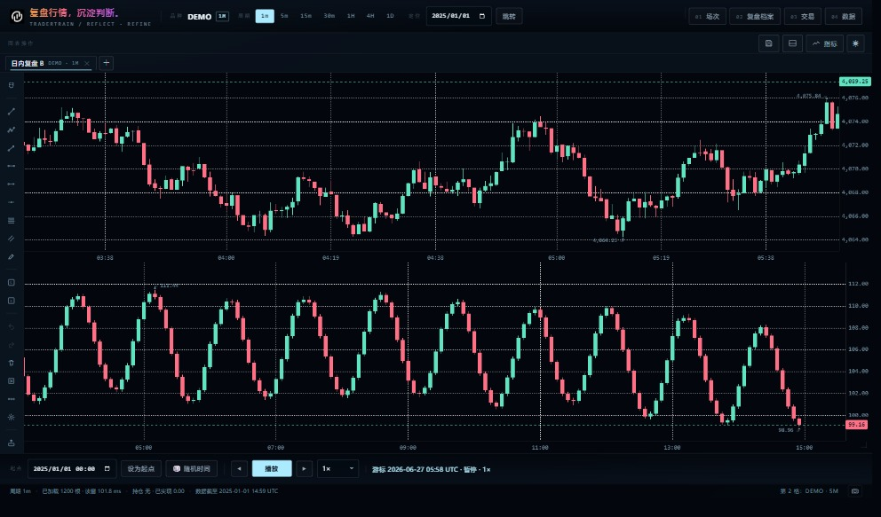

## 11. 场次（复盘）

点顶部「场次」打开面板：

- **新建场次**：丢掉当前交易列表重新开始（名称取输入框，留空自动生成）；**结束场次**打结束时间；
- 统计：笔数 / 胜率 / 净盈亏 / 盈亏比 / 期望每笔 / 最大回撤 / 胜负数 / 最多连赢连输（初始权益 100,000）；
- **开仓、平仓各自动截一张图**（拼合 6 层 canvas），点缩略图看原图；
- 导出 **JSON**（含元数据/逐笔/截图索引/统计）与 **CSV**（UTF-8 BOM，Excel 直接开）；
- 历史场次列表可切换查看或删除（删除需连点两次「删除」）。
- 关掉浏览器再开，自动续上最后活动的场次。

## 12. 复盘报告（打印 / 另存 PDF）

复盘档案里每行点「报告」：生成一份页内报告（统计 8 项 + 成交明细 + 截图 + 备注），直接用打印对话框「另存为 PDF」。
报告只在打印时可见（`#reportRoot` + `@media print`），不开新窗口、不受弹窗拦截影响。

## 13. 自编指标（Pine Script）

点顶部「指标」打开面板：

1. 「示例」填一段 EMA 20/50；或直接粘贴自己的 `//@version=5 indicator(...)` 脚本；
2. 「检查」编译并显示输出条数与主图/子图，报错会带行号（如「第 3 行」）；
3. 「保存并加图」写入本地指标库并挂到图表；
4. 脚本里有 `input.int/float/bool/string` 时，面板会生成参数输入框，改完立刻重算；
5. `overlay=true` 挂主图，`false` 自动建子图；指标库列表可「载入/上图/删除」。

支持 `plot / hline / input.* / ta.* / 变量与条件`；`strategy.*`、`request.security` 不支持（v2）。

## 14. Pine 在 Worker 里跑

`pineWorker.js` 把 PineTS 整段执行搬到 Worker：重脚本不再卡主线程（实测 7 s 的脚本执行期间界面仍保持 ~62 fps）。
- 主线程 `compilePine()` 自动发现 Worker 不可用（CSP / 老内核）就回退到主线程，行为一致；
- 单次编译 15 s 超时保护，超时也回退；
- 回传只带结构化数据（序列 + 绘图对象 + 策略状态），`transpiledFn` 不出 Worker。

## 15. 策略回测（Pine `strategy`）

Pine 编辑器里的「回测」按钮：跑一次脚本 → 读 PineTS 的 `ctx.strategy` → 出

- 统计：成交笔数 / 净盈亏 / 胜率 / 盈亏比 PF / 期望每笔 / 最大回撤（含 %）/ 连胜连亏 / 期末权益（含浮盈）
- 权益曲线（按逐笔累加，本金为基准线）
- 成交明细：方向、数量、开仓时间价、平仓时间价、盈亏（最多列 300 行）

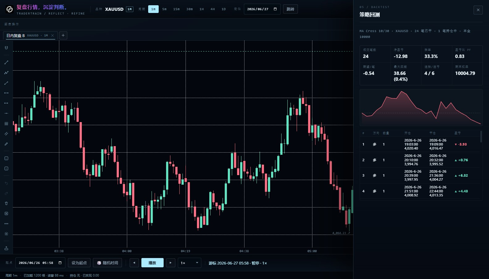

## 16. 脚本提醒（Pine `alert()`）

脚本里的 `alert()` 会在编译/上图时被收集：Pine 编辑器「提醒」按钮打开面板，列出时间 + 内容（最近的在前），按钮上带角标。

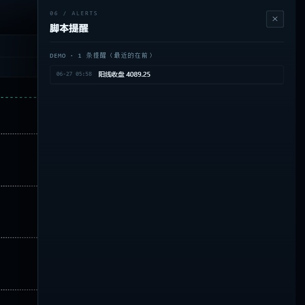

## 17. 绘图管理

左侧工具栏最下面的 ▤：列出当前格当前周期的所有绘图（类型、时间、价格），支持**全选 / 删除选中 / 清空当前周期**。

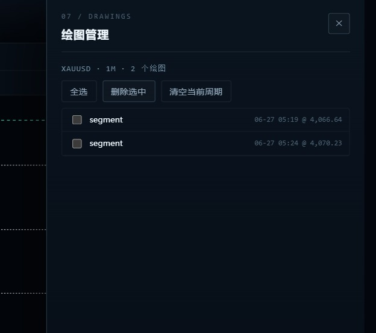

## 18. 历史数据下载（页面内，Dukascopy + Binance 合并列表）

「04 数据」→ **历史数据下载**：搜标的 → 选区间 → 下载并导入，全程不用离开应用。

```
04 / DATA · 数据管理
┌ 历史数据下载              Dukascopy · UTC ┐
│ [ 搜索标的：XAUUSD / 黄金 / 外汇 ]         │
│   XAUUSD  黄金/美元                金属    │
│   XAUEUR  黄金/欧元                金属    │
│ 已选 XAUUSD 黄金/美元 · 金属               │
│ 周期 [1 分钟]      价格 [BID ▾]            │
│ 从 [2025-11-02]  到 [2026-11-02]           │
│ [下载并导入]  [取消]                       │
│ ▓▓▓▓▓▓▓▓░░ 下载 12/20 天 · 16,332 根       │
└────────────────────────────────────────┘
```

- **一个列表 = 两个数据源**，不用先选源：外汇/金属/指数走 **Dukascopy**，加密走 **Binance 官方归档**，行尾会标 `DUKA` / `BINANCE`
  - 共 48 个标的（Dukascopy 29 + Binance 19）；加密自动用 Binance（真实成交量、7×24），价格下拉自动置灰
  - 中文简称也能搜：`纳指`→纳斯达克100、`标普`→标普500、`道指`、`德指`、`日经`、`黄金`、`大饼`、`狗狗币`…
  - 清单内置在前端 `app/src/instruments.js`，**搜索不依赖后端**；只有真正下载才需要 `/api/*`
- **交易日历按品种区分**：加密 7×24（周末照样有 K 线，不跳）；外汇/金属/指数按交易日（周末休市，选了纯周末区间会明确报错）
- **区间严格裁剪**：Binance 月包是整月数据，导入前会按你选的 `从/到` 切掉多余部分（选 6/15–6/20 就只进 6 天）
- **「补到昨天」按钮**：一键把已有档案续到 UTC 昨天，只补缺失部分——
  - 起点 = 档案最后一天（含当天，覆盖可能不完整的边界 K 线），终点 = UTC 昨天
  - **增量合并**：只重写“受影响的年份分片”，没动的年份直接沿用旧分片 key（不重写、不重下）
  - 同时间戳以新数据为准；最后一天已是最新时按钮置灰并提示「已是最新」
- **加密按“月”抓**（Binance 月包）：一个月 1.9 MB / ~2 s；当月没有月包会自动退回按日抓
- **缓存**：Dukascopy 按天 `.cache/duka/…`，Binance 按月 `.cache/binance/…`，成品 CSV 在 `.cache/jobs/…`
- **周期**：只有 1 分钟可选——5m/15m/30m/1H/4H/1D 都由应用内从 1m 聚合，重复下载没意义
- **价格源**：BID / ASK
- **落库**：走和 ZIP 导入同一套管线（按年分片、写 IndexedDB、自动加载上图）
- **断点/缓存**：按天缓存在 `.cache/duka/<品种>/<年>/<月>/<日>.csv`，同一段再下一遍直接命中缓存
- **服务端**：`tools/serve.py`（`start.bat` 已改为优先用它）。它做 LZMA 解压、按天并发、503 退避重试、按日期排序拼接

> 若用 `python -m http.server` 手工起服务，没有 `/api/*`，面板会提示"当前服务没有下载接口"。

实测（本机网络，Dukascopy 单日响应 2–30 s 不等）：
- 单日（已缓存）→ 导入：2 s
- 单日（现下载）→ 导入：12 s
- 一个月 20 个交易日 → 26,989 根：**124 s**（约 6 s/交易日）
- 一年约 40–60 分钟；建议按年分段下，第二次重下走缓存是秒级

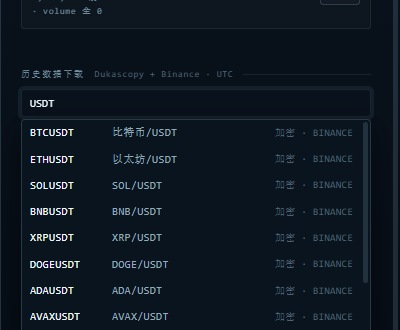


### 跳到最新 K 线

顶栏第二行「»| 最新」按钮（`#btnLatest`）：一键回到实时边缘。

- **会退出回放**：如果回放开关是开着的，点它等于关掉回放（回放条收起、播放停止），游标对齐到最新一根 bar；
- **会切回实时**：如果实时没在跑且 `/api/live` 能取到数据，顺手把采集拉起来；
- 状态栏提示 `已跳到最新 K 线 · 实时中 · <时间>`；
- 解决「打开程序停在上一位置」：不用管上次停在哪，点一下就到最新。

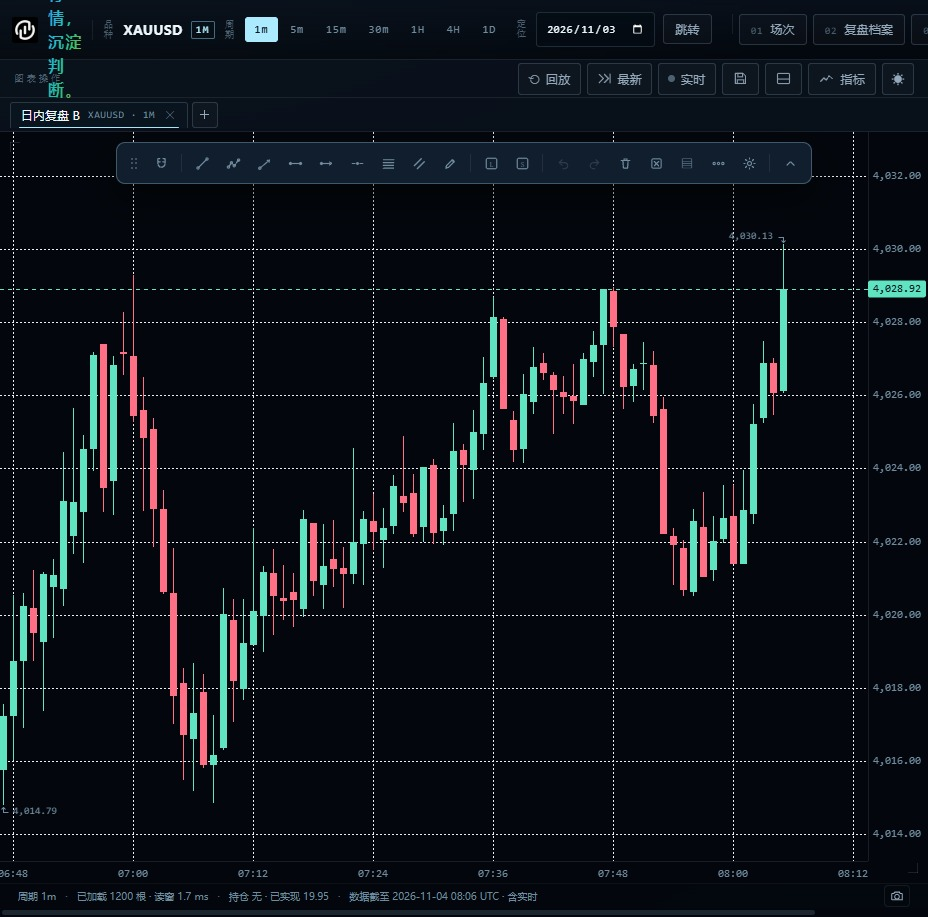

### 回放模式开关

顶栏第二行最左「⟲ 回放」按钮（`#btnReplay`）是回放功能的**唯一入口**：

- **默认关闭**：不打开时，起点输入、设为起点、随机时间、回退/播放/前进、速度选择**全部不出现**（`#replayBar[data-on="0"]` → `display:none`），画面就是实时视图，锚在最晚一根。
- **点开后**回放条才出现；关掉的瞬间会先暂停，再把画面送回最新一根，避免停在半路。
- 状态记在 `ui:replay`，下次启动按上次的选择恢复。
- 关闭状态下键盘 `空格/←/→` 仍可用（按钮只是藏起来，不是禁用），需要纯看图时不会误触。

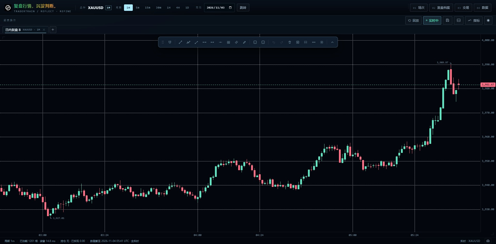

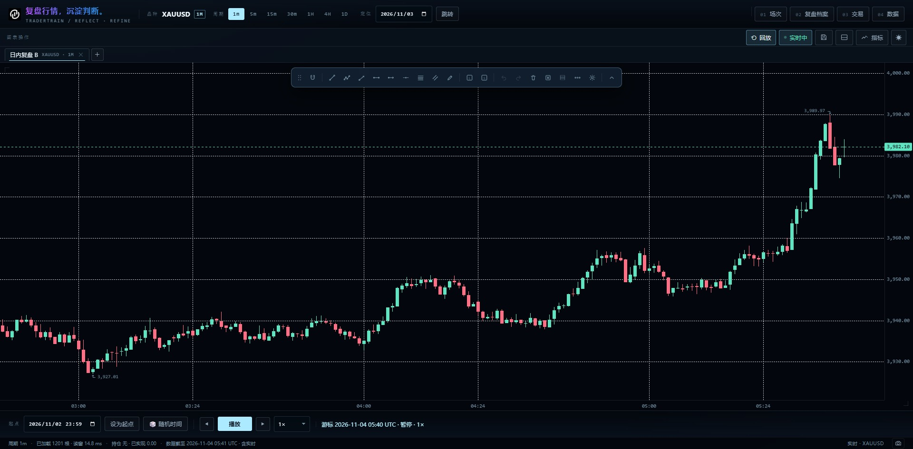

### 启动自动补缺口

`04 数据` 下载区有一个勾选框「启动自动补缺口」（**默认开**，记在 `ui:autogap`；手动取消后不再自动补）。

打开后，每次启动会做一次检查：**历史尾部 → UTC 昨天**之间有空洞就自动跑一次 Dukascopy 下载并合并入库，跑完自动刷新图表；没有空洞就直接跳过（不发请求、不弹提示）。同一页面生命周期只试一次，避免导入后 `loadProfile` 递归触发。

- 只补**日线级历史**：实时段（当天）由 biquote 负责，5 小时以外的空洞 Dukascopy 才有（T+1 发布）。
- 补的过程可继续看图，状态栏会显示 `自动补缺口：…`；完成后提示 `已续传 X 根`。
- 幂等：同一段日期重复补，第二次是 `新增 0 根`（重叠部分去重）。

这条链路同时修掉了一个真 bug —— 续传时把 `subarray` 的**整块 backing buffer** 写进分片，尾部未使用的容量变成一批 `ts=0` 的假记录（实测一次 2,762 条），表现为分片末尾时间戳为 0、`meta.last` 变 0、按时间二分读不到数据。现在写库前统一裁成精确 `ArrayBuffer`，并在合并时丢弃 `ts<=0` 的脏尾巴。

### 实时（biquote）

顶栏第二行「● 实时中」按钮（`#btnLive`）：开着的时候每 **1 s** 拉一次 biquote 的 1 分钟线，**收盘那根自动入库**。

- 数据源：`biquote.io`（免费、无 key，聚合 MT5 经纪商报价）。服务端经 `GET /api/live?symbol=XAUUSD&limit=N` 代理，避开 CORS。
- **只落已收盘的 bar**：正在走的那根（`isOpen=true`）只用来更新画面；`isOpen=false` 才写库。
- 写入节奏：内存攒 30 s 或 20 根，一次事务写进独立 store `live`（键 `<profileId>|<YYYYMMDD>`，一天一个分片）。
- **不污染历史分片**：`chunks` 的 `<profile>@<importId>/<year>` 命名空间完全不动，读窗口时把 live 段按 ts 并进来。
- **同 ts 以历史为准**（Dukascopy > biquote）：Dukascopy 补齐后，那天的 live 分片可以删掉。
- `volume` 字段存的是 biquote 的 `tickVolume`（tick 计数，不是真实成交量），profile 里有 `volumeKind: 'tickCount'` 标记。
- 启动时**回补**最近 1000 根（biquote 的 1m 上限，约 5 小时）；运行中如果本地最新那根落后超过 **2 分钟**（断线/休眠/关过页面），下一轮自动多拉 120 根补齐。
- **tick 计数不当成交量**：biquote 给的是 `tickVolume`，不是真成交量，所以在图里成交量维度一律是 0（「无成交量」标签、VP/订单墙的退化路径都照旧），原始 tick 数仍留在 live 分片里。
- **回放期间实时照常采集**：轮询、收盘入 live 分片都不受回放影响；只是**不会往图上推**——只有窗口就在实时边缘（距最后一根 ≤2 根 K）时才 append，回放停在 2024 时窗口不会被拽到今天。回到实时边缘后自动续上。
- **启动不预探活**：只要「实时」不是手动关的，启动就直接开采集；连上游慢/短暂失败由 feed 每 3 s 自己重试，错误会显示在状态栏（延迟 / 错误）。**没有任何一次探测失败会导致实时被静默关掉。**
- **30 s 看门狗**：设置是“开”但没在采集（feed 丢了、轮询卡住超过 60 s，例如休眠唤醒后 timer 停了）→ 自动重启采集并写一条 `[live] 看门狗重启` 到控制台。
- **刷新节奏**：1 s 轮询（固定节拍，扣掉请求耗时）+ 未收盘那根**原地更新**收盘价，实测「价格变化」平均间隔 **1.05 s**。上游 biquote 本身就是 1 s 一档（`quoteAgeSeconds` 0–1），再快没有意义；biquote 限流 15,000 次/分钟，我们只用 60 次。
- **窗口掉队自动追赶**：图表末根落后实时不超过 **10 分钟**时，会把缺的 bar 增量补进去（落后 >120 根才整窗重载）；落后更多说明你是主动停在历史，程序不会把你拽回来——点「最新」或开回放再定位。
- **进入程序默认实时**：如果 `/api/live` 能取到数据且用户没手动关过（`ui:live !== false`），启动后自动开；关掉一次就记住，下次不再自动开。
- 状态栏「数据截至」会自动变成 `… · 含实时`；按钮 hover 显示最近一根时间 / 待写 / 已入库根数。

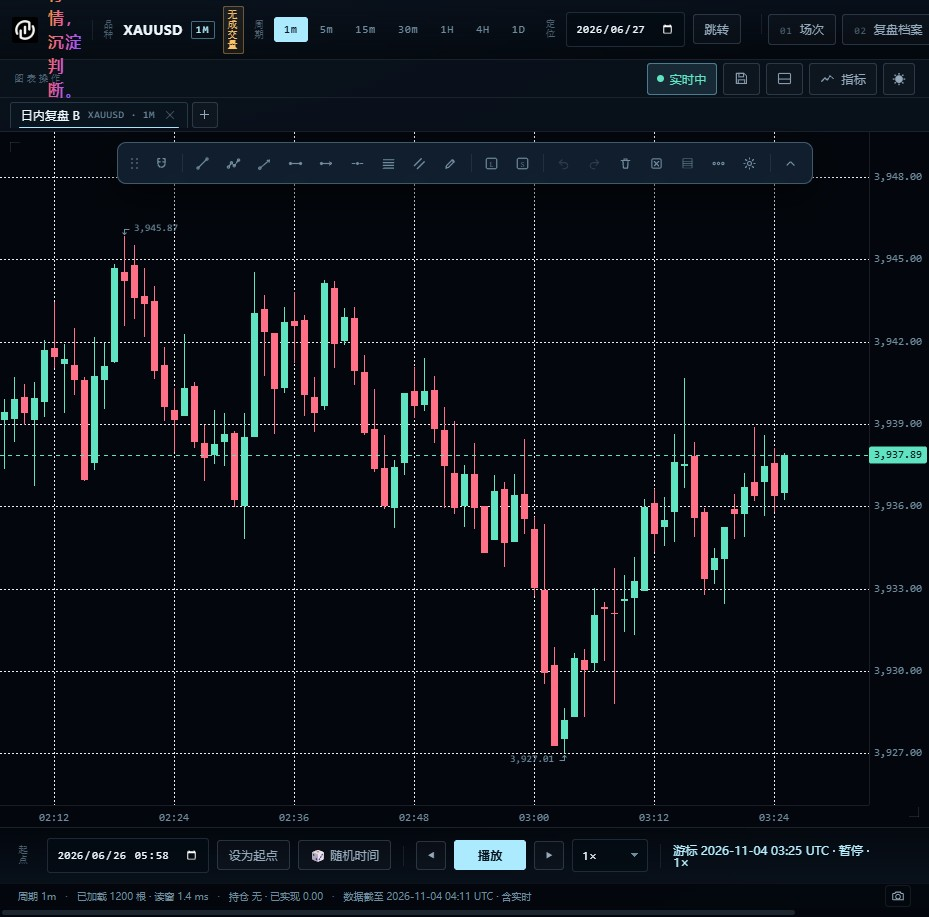

## 19. 从 ZIP / CSV 导入（本地文件）

「04 数据」面板里有一块 **从 ZIP / CSV 导入**：把 `.zip`（可含多个 csv）或单个 `.csv` 拖进去（或点「选择文件」），点「导入」即可，**不需要先跑 Python 工具**。

```
┌ 从 ZIP / CSV 导入       本地文件 ┐
│  把 .zip（内含多个 csv）或 .csv 拖到这里   [选择文件] │
│  品种 [自动识别]                        [导入] │
└──────────────────────────────┘
```

- **一个 zip 里多个 csv**：按年份拆的会合并成一个档案；文件名能区分品种时按品种分组（`XAUUSD_2024.csv` → `XAUUSD`），也可以在「品种」里手工指定
- **解压**：用浏览器内置 `DecompressionStream('deflate-raw')`，支持 stored / deflate；ZIP64 会明确报错让你重压
- **CSV 兼容**：表头自动识别（`datetime/time/date`、`open/high/low/close/volume`，中英文列名都认），分隔符自动判（`,` `;` `\t` `|`），UTF-8 优先、坏了退回 GBK；无表头按 `时间,开,高,低,收[,量]` 读
- **时间**：支持 `YYYY-MM-DD HH:MM[:SS]`、`YYYY/MM/DD`、`DD.MM.YYYY HH:MM:SS[.mmm]`（Dukascopy 导出）、ISO 带时区、epoch 秒/毫秒；**不带时区按 UTC**
- **列名**：`time` 单独一列也认（Dukascopy / 部分交易所导出）；`Date`+`Time` 两列同样认（MT5）
- **校验**：只接受 1 分钟数据（相邻间隔 <60s 或多数 ≠60s 直接拒绝并说明原因）；同时间戳去重；按年切片；单价存 int32×1000 定点
- **落库**：与 manifest 导入走同一套 `chunks`（`<品种>-1m@<importId>/<年份>`），写新版本成功后才切档案、再删旧分片；中途取消整批回滚
- **上限**：单次 1 GB（≈38.3M 根），超了提示拆分批次

实测（本机 Chrome）：355,234 行 zip 用时 0.5 s；3 年 1,018,913 行（12.1 MB zip）用时 1.5 s。

离线批量转换仍可用：`tools/csv2bin.py` + `tools/make_manifest.py`（产物在 `data/bin/`，由「可导入」列表导入）。

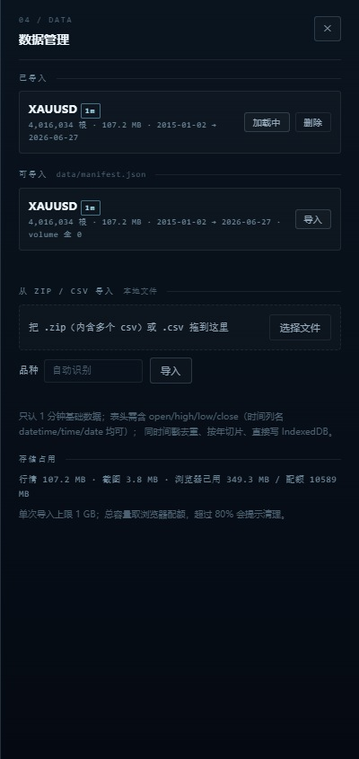

### 换机迁移（配置 / 行情）

`04 数据` 面板底部「换机迁移」四项：

| 按钮 | 产物 | 内容 |
|---|---|---|
| 导出配置 | `trader-train-config-YYYYMMDD-HHMM.json` | 除行情清单外的全部 `kv`：主题、版面、TAB、指标偏好/收藏/组合、绘图样式与条目、场次、复盘档案索引、Pine 库 |
| 导入配置 | 同上 json | 覆盖同名键；**不动行情清单**（不会把目标机已导入的品种清空），完成后自动重载 |
| 导出行情 | `trader-train-data-YYYYMMDD-HHMM.ttdata` | 已导入全部品种的 K 线二进制（28 B/根，不压缩）+ 行情清单 |
| 导行情包 | 同上 `.ttdata` | 写入分片并合并清单；同 id 以包内为准，完成后自动重载 |

- `.ttdata` 结构：`"TTDATA1\n"`（8 B）+ `uint32` 头长度（小端）+ JSON 头（`profiles` / `chunks[{key,bytes}]`）+ 各分片原始字节顺序拼接。导入会先校验魔数与长度，包被截断会直接报错而不是写一半。
- 单包上限 1.4 GB（超过就让分品种导）。实测 4,016,034 根 / 107.2 MB：**导出 866 ms、导入 634 ms**。
- 换机顺序：**先导配置 → 再导行情包**（配置里不含清单，顺序反了也不会丢，但清单以包内为准）。
- 端口仍是命根子：新机器必须还是 `http://127.0.0.1:8733`，否则 origin 变了读不到旧数据。
- **vela 分支端口 = 8733**（2026-11-05 起；8731 让给主仓库打包 exe，两者可并存）。
  origin 变更时 IndexedDB 不随端口迁移（Chrome 元数据绑定 origin）——全量历史已在 8733
  重新导入（csv2bin 全量 CSV → manifest → 页面导入）；旧 8731 origin 的实时段（liveStore）
  需重新收集。

## 20. 数据格式（28 B/根，小端）

| 偏移 | 类型 | 含义 |
|---|---|---|
| 0 | int64 | 时间戳（ms，UTC 解释） |
| 8 | int32 | open × 1000 |
| 12 | int32 | high × 1000 |
| 16 | int32 | low × 1000 |
| 20 | int32 | close × 1000 |
| 24 | float32 | volume |

定点存储避免 float32 在 4000 量级上 1.2e-4 的误差（会影响 SL/TP 触发判定）。
读取时 `DataView.getBigInt64/getInt32/getFloat32` 必须显式传 `true`（小端），否则时间戳全乱。

## 21. 重新生成数据

```bat
python tools/csv2bin.py "D:\Crypto\code\Axiom\data\XAUUSD_1.csv" .\data\bin\xau --symbol XAUUSD
python tools/make_manifest.py
```
全量约 3 分钟 / 108 MB。只转某几年加 `--year-from 2024`。

## 22. 图标与桌面快捷方式

图标来自 `app/assets/logo-source.png`（Logo 原图，256×256），由 `tools/make_icon_from_png.py` 一键转整套。

三层图标都指向 `app/assets/icon.ico`：

| 位置 | 靠什么生效 | 怎么改 |
|---|---|---|
| 窗口左上角 / 任务栏 / Alt+Tab | 页面 `<link rel="icon">`（Chrome `--app=` 窗口直接拿页面 favicon） | 换 `app/assets/icon.ico`，窗口 `Ctrl+R` |
| 桌面 / 开始菜单快捷方式 | `.lnk` 的 `IconLocation` | 重跑 `make-shortcut.bat` |
| 以后打包 exe | PyInstaller `--icon app/assets/icon.ico` | 打包时带上参数 |

### 生成图标

```bash
# 白底黑线（当前使用，和原图一致）
uv run --with pillow --with numpy python tools/make_icon_from_png.py app/assets/logo-source.png --ink 131313

# 深底亮线（想要更贴合深色皮肤时）
uv run --with pillow --with numpy python tools/make_icon_from_png.py app/assets/logo-source.png --dark --ink e8f2fa

# 看 16/24/32/48/64 的真实像素
uv run --with pillow python tools/icon_sheet.py
```

产出：`icon-16/24/32/48/64/128/192/512.png`、`icon-maskable-512.png`、多尺寸 `icon.ico`（16→256 全内嵌）、`docs/icon-preview.png`。

脚本流程：亮度覆盖率 **× alpha** → 裁到墨迹外框留 7% 边距 → 4 倍超采样渲染 → 小尺寸（≤32）加粗并把线条压深/提亮 → 打包多尺寸 ICO。

> 覆盖率必须乘 alpha：带透明圆角的素材如果不乘，透明但 RGB 偏暗的四角会被当成墨迹涂黑。

### 生成快捷方式

双击 **`make-shortcut.bat`**：桌面 + 程序目录各一个 `TraderTrain.lnk`，目标 `start.bat`（窗口最小化，不留黑框），图标 `app\assets\icon.ico`，脚本回读校验。


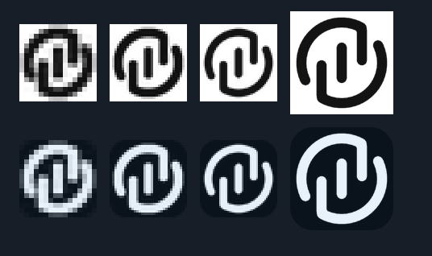


## 23. 已知限制

- XAUUSD 源数据 `volume` 全为 0 → 不提供成交量面板。
- 源时间非 UTC（每天缺 06:00 整点、周一 07:00 开）；当前按原时间直读，日线聚合按 UTC 00:00 切。
- 2023 年数据偏薄（308,752 根，正常约 353k），该区间不宜做精确统计。
- 单次导入上限 1 GB（应用层）；总容量取决于浏览器配额（本机实测 10,309 MB）。
- Pine 只支持 `indicator()`：`request.security` 返回 null、`syminfo.mintick` 为 NaN、`barstate.isconfirmed` 现按 `bar_index < n-1` 判定（最后一根不算确认）。
- Pine 计算范围是**当前窗口**（1200–1280 根），切周期/暂停时重算（约 51 ms），不是全历史序列。
- 截图依赖图表可见；后台标签页可能抓到空图（已加就绪等待与重试）。
- 删除操作都是「连点两次」而非弹窗确认（原生 `confirm/prompt` 在 WebView 下会阻塞页面）。
- 抽屉动画只动 `transform`：用 `opacity` 时后台标签页会暂停动画，窗口切回来前一直是半透明。

## 24. 其它

- **时间戳**：全站显式 UTC；状态栏显示「数据截至 … UTC」。
- **成交量缺失**：源数据全 0 时顶栏挂「无成交量」标签并说明，避免误以为脚本坏了。
- **ZIP64**：支持 ZIP64 EOCD 与 0x0001 扩展字段（>4 GB 包也能列目录/解压）。
- **无障碍**：`:focus-visible` 统一焦点环；71 个 `aria-label`（图标按钮在运行时按 title 自动补）。

## 25. 设计规则参考（financial-ui-suite）

`docs/design/financial-ui-suite/` 是从 [rgourley/financial-ui-suite](https://github.com/rgourley/financial-ui-suite)（MIT）同步来的纯 markdown 规则集：17 条金融 UI 正确性规则 + 14 套视觉风格参考。本项目只取规则，不引其 React/Tailwind 代码。

- 刷新：`bash tools/sync-design-refs.sh`
- 逐条比对结论：`docs/UI-AUDIT-2026-11-03.md`
- 已落地：按资产定小数位（`instruments.js → decimalsFor/fmtPrice/fmtQty`，`chart.js` 建图与载入后各设一次精度）、数字等宽 `tabular-nums` 覆盖成交/持仓/统计/状态栏

## 26. 稳定性与工程化

### 实时推送（SSE，2026-11 起）

`/api/live/stream?symbol=XAUUSD` 是 `text/event-stream`：服务端**每个品种只跑一个**后台轮询线程
（1 s 一次 biquote），把结果推给所有打开的窗口 —— 三个图窗只消耗一份上游流量。

客户端 `live.js`：

| 层 | 行为 |
|---|---|
| 快路径 | `EventSource` 收到 `bars` 直接走 `_ingest()`，实测延迟 < 1 s（`streamTicks` 计数） |
| 兜底 | 轮询仍在，但流健康时降到 **5 s** 一次（`POLL_MS_SAFE`） |
| 断流 | `onerror` ×3 关掉 ES 回到 1 s 轮询；下一轮 poll 成功自动重开 |

`GET /api/live` 保留原样（一次性拉取，供补洞与探活用）。

### 错误日志

`logErr(where, e)` 是统一出口：默认 `console.warn`，URL 加 `?debug=1` 升级成 `console.error`（带堆栈）。
排查“某功能静默失效”时先开 `?debug=1`。

### exe 退出原因

`packaging/trader_train.py` 注册了 `atexit` / `sys.excepthook` / `threading.excepthook` / `faulthandler`：

- `%LOCALAPPDATA%\TraderTrain\server.log` → 正常退出 `exit; pid=…`，未捕获异常 `FATAL:` + 堆栈
- `%LOCALAPPDATA%\TraderTrain\crash.log` → 原生崩溃（faulthandler）的 C 栈

### 自检怎么跑

```bash
# 单个用例：浏览器开 http://127.0.0.1:8733/app/index.html?selftest=45
# 全部用例（需要 Chrome 带 --remote-debugging-port=9222）
python tools/run_selftests.py --port 9222 --tests 1-45 --fresh --json report.json
```

`--fresh` 会在每个用例前执行 `resetForTest()`：清成交、提醒、图上绘图与落盘绘图、SMC 指标、
绘图样式/模板（`ui:drawStyles`/`ui:drawTemplates`）、Pine 库与映射、回放开关。

**已知边界**：这是“运行态”清理，不是“干净库”。依赖**默认设置**的用例（5 绘图样式、18/19 指标配置、
23 指标库、24 SMC、28 结构面板、35 Pine 矩阵）要求 IndexedDB 里没有旧偏好；连续跑它们时仍可能因为
上一个用例写入的偏好而失败 —— 单独跑或先清站点数据即可。真正的隔离做法是换 origin
（`python tools/serve.py --port 8732`，IndexedDB 按 host:port 隔离）再导入 fixtures。`window.__UI_READY__` 是页面就绪标志，`window.__RESULT__` 是用例结果。

### 快捷键表

按 `?` 打开、`Esc` 关闭（`#helpPanel`）。

### SMC 面板

右下角面板现在可**拖动**（指针拖动，位置存 kv `ui:smcPanel`）、**双击折叠/展开**。
