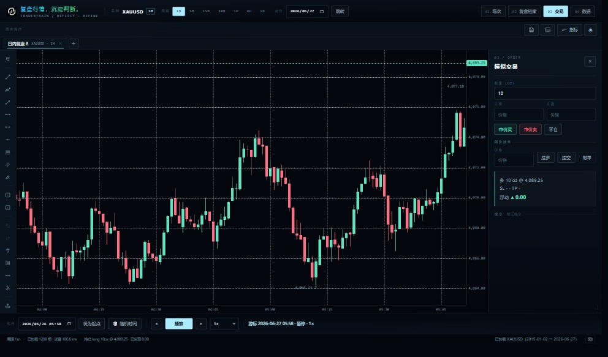
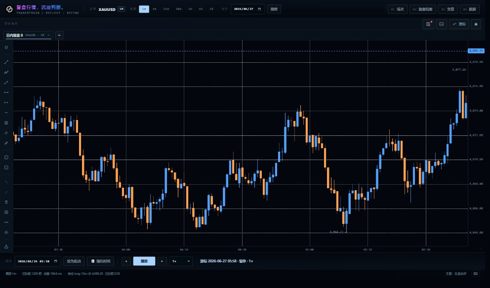

# UI 体检：对 financial-ui-suite 的逐条比对（2026-11-03）

对象：`github.com/rgourley/financial-ui-suite`（MIT，2026-06-02，7★）
性质：**Claude 技能包（17 条 correctness 规则 + 14 套视觉风格的 markdown 参考）**，不是组件库、没有可 import 的代码。
结论：**能辅助，但只能当“规则清单”用** —— 本项目是原生 ESM + klinecharts、无 React / Tailwind / 构建步骤，插件里的 TSX 示例不能直接搬；里面的判定标准（数字格式、颜色语义、密度、空/错状态、图表交互）可以直接套。

参考已落库：`docs/design/financial-ui-suite/`（`tools/sync-design-refs.sh` 可随时拉新版）。

切分：`financial-ui-patterns` 是必读的正确性层；`financial-ui-styles` 里与本项目最接近的是 **modern-pro-dark**（TradingView / Kraken Pro / Hyperliquid），现在这四套主题（dark / light / sky / amber）可视为它的变体。

---

## P0 已修（本轮）

| 规则（出处） | 之前 | 现在 |
|---|---|---|
| 按资产定小数位（number-formatting.md） | `chart.js` 写死 `pricePrecision: 2`；21 处 `toFixed(2)` 显示价格 | 新增 `instruments.js → decimalsFor/fmtPrice/fmtQty`；`chart.js` 建图时按标的定精度，数据到手后 `applyPrecisionFromData()` 再按真实量级校正 |
| — | 加密小价币全会显示成 `0.00` | `SHIB 0.0000123 → 0.00001235`（8 位）；`BTC 43251.5 → 43,251.50`；`XAU → 3,874.59`；`EURUSD → 1.083`；`USDJPY → 148.521`；指数 → 1 位 |
| 数量格式（同上） | 数量一律 2 位 | 加密最多 8 位、外汇/金属 2 位：`0.00123456 BTC`、`1.5` |
| 数字等宽（typography-and-color.md · Numeric type） | 只有 3 处 `tabular-nums`（统计块 / 一张表 / pine 表） | 补到成交列表、持仓、场次统计、状态栏、图例数值、复盘档案行 |

验证（浏览器实测 `decimalsFor` / `fmtPrice`）：

```
XAUUSD 3874.5912 → 3,874.59      BTCUSDT 43251.5  → 43,251.50
SHIBUSDT 0.0000123456 → 0.00001235   EURUSD 1.08342 → 1.083
USDJPY 148.521 → 148.521         USATECHIDXUSD → 1 位
chart.getSymbol().pricePrecision = 2（XAUUSD）
```

---

## P1 已完成（2026-11-03）

1. **类型刻度 token 化** —— `:root` 新增 `--fs-2xs:9 / --fs-xs:10 / --fs-sm:11 / --fs-md:12 / --fs-lg:13 / --fs-xl:15 / --fs-2xl:21`；
   全文件 139 处 `font:` / `font-size:` 由裸 px 换成 token（半像素 8.5/9.5/10.5/11.5/12.5/13.5 就近归并，视觉差异 < 1px）。
2. **数字读数 = sans + `tabular-nums`** —— `#posBox b / .pos / .neg / .trades .t / .stats .s b / .readout / #status / 图例数值 / 复盘档案行 / 下载行` 全部改 sans + 等宽数字；
   mono 只保留给品种代码、时间戳、指标参数、微标签。
3. **涨跌不靠颜色单打** —— `.pos::before` 加 `▲`、`.neg::before` 加 `▼`（纯 CSS，4 处盈亏点全覆盖），并新增第 5 套主题 **色盲友好（cb）**：
   墨蓝底 + **蓝涨 `#4fa3ff` / 橙跌 `#ffa14a`**（红绿色觉障碍可分），与其余四套同样走 `setTheme` + `ui:theme` 持久化。

实测：`?selftest=34` 3.3 s 通过；回归 `?selftest=1..34`（33 项）全绿。




## P1 待做（原 4-6 项）

4. **焦点态与键盘可达性**
   出处：accessibility.md。
   现状：`:focus-visible` 只有 1 条规则，工具栏/顶栏图标按钮无 `aria-label`（只靠 `title`）。
   做法：统一 `:focus-visible` 环、图标按钮补 `aria-label`、Tab 顺序过一遍抽屉。

5. **空/错/加载态**
   出处：empty-and-error-states.md、loading-and-skeletons.md。
   现状：指标库已有空状态卡；下载、复盘档案、场次为空时还是白板。
   做法：三处补同款空状态卡（标题 + 一句解释 + 主操作）。

6. **时间戳统一 “as of” 语义**
   出处：timestamps-and-timezones.md。
   现状：状态栏/图例/复盘档案各写各的（有本地时间也有 UTC），没有明确标注。
   做法：统一 `2026-11-02 23:58 UTC` 显式时区 + 「数据截至」文案。

## P2 参考（暂不做）

- 成交量面板的 histogram + VWAP 叠加（charts-and-candles.md）——本项目源数据 `volume` 全 0，等接入 Binance 真实成交量再做。
- 虚拟化表格（virtualization.md）——成交/场次行数目前远小于 100，没必要。
- 移动端底部抽屉（mobile-and-responsive.md）——桌面 app 形态，不适用。

---

## 不适用清单（避免照搬）

| 插件里的东西 | 为什么不用 |
|---|---|
| React/TSX 组件示例 | 本项目是原生 ESM + 手写 DOM，不引框架 |
| Tailwind token 类名 | 无构建链，直接用 CSS 变量 |
| 订单簿 / 逐笔成交（T&S）面板 | 回放场景没有 L2/T&S 数据源 |
| 14 套风格整套移植 | 只用其中 1 套（modern-pro-dark）当基线，现有四主题保持不变 |
| `ws.onmessage` 节流/重连 | 本项目是本地回放，不是实时推送（版本看门狗另算） |
