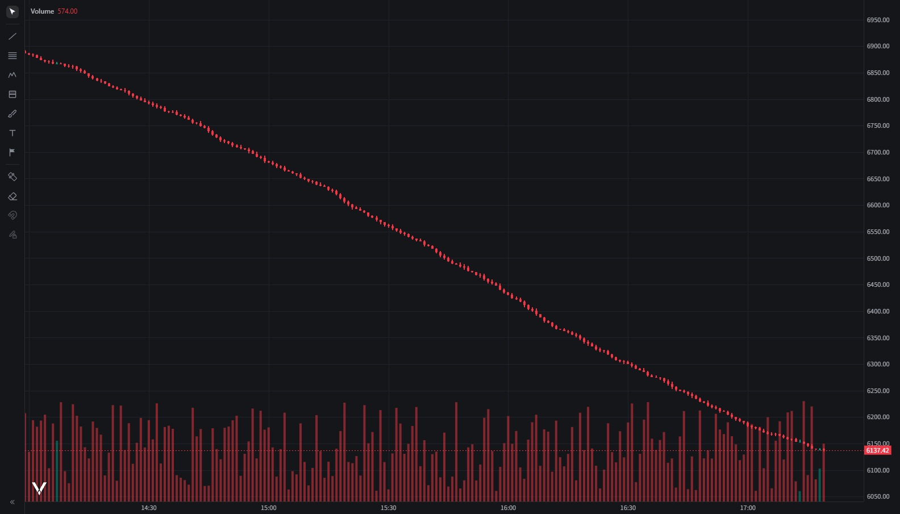

# 迁移到 LuxAlgo Vela 的可行性评估（2026-11-03）

评估对象：`github.com/luxalgo/vela`（Apache-2.0，npm `@luxalgo/vela@0.9.3`，2026-07-13 建库，1186★）
当前实现：自建 UI + `klinecharts@10.1.0`（Apache-2.0，240 KB）+ PineTS 0.13.1（AGPL，自用）

---

## 结论

**现在不建议整体迁移。** 技术上可行（我做了实跑验证），但代价是**重写 9,054 行应用代码里的大半**，同时接收一个 **0.9.x、4 个月发了 47 个版本**的库做底座。

值得考虑迁移的唯一场景：你想要 **67 个原生绘图工具 + WebGL2 性能 + 键盘优先的 workspace**，并且愿意接受 2–4 周重写 + 后续跟 API 变动。

**建议路径**：先做 3 天 POC（数据 provider + 回放游标 + 1 个 SMC 指标 + 1 个 Pine 指标 + 主题），POC 过了再排期；或者等 Vela 出 1.0。

---

## 一、实跑验证（不是纸面推断）

在 `%LOCALAPPDATA%\Temp\vela-spike` 用 esbuild 打成单文件，静态起在 8732 端口，本地离线渲染：

| 项 | 实测 |
|---|---|
| 核心包（`@luxalgo/vela`，minify + bundle） | **1.13 MB** 单文件 ESM |
| workspace 包（`@luxalgo/vela/workspace`） | **1.43 MB** 单文件 ESM |
| 对照：当前 klinecharts 单文件 | **240 KB** |
| 1,500 根离线建图 | **45.4 ms**，7 层 canvas（WebGL2） |
| 50,000 根离线建图 | **37.8 ms**，JS 堆 18.3 MB |
| 依赖 | 仅 7 个 `@zag-js/*`（菜单/弹窗/tooltip），无 peer deps |
| 离线可用 | ✅ `new Vela('#chart', { data: bars })` 完全本地，不需要 provider |
| 免构建运行 | ✅ 预打包一次即可，运行时仍是静态 ESM（符合我们现在的零构建形态） |

结论：**"能不能跑、能不能离线、能不能免构建"这三关都过了。**



## 二、能力对比

| 能力 | 现在（klinecharts） | Vela 0.9.3 | 迁移收益 |
|---|---|---|---|
| 渲染 | canvas2d，多 canvas | WebGL2 + canvas2d 兜底 | 大数据量/深缩放更顺 |
| 绘图工具 | 自写约 20 种（`draw.js` 385 行 + 6 个 overlay + `drawStyles.js` 192 行） | **内置约 67 种**，含磁吸 3 态、测量器、橡皮、收藏、Alt 快捷键 | ★★★ 直接省掉一整块自研 |
| 指标 | klinecharts 模板（`calc`/`figures`/`draw`） | 原生指标 + 插件 SDK，场景模型有 `DrawingLine/Box/Label/Polyline/Linefill/Table` | ★★ 结构更正规，但要重写 |
| Pine | 自建桥：PineTS + `preprocessPine` + 坐标映射 + DOM 表格（`pine.js` 455 + `pineDraw.js` 225） | 官方 addon `@luxalgo/vela-pinets`（同一个 pinets 运行时，支持 Worker、inputs schema、`request.security` 走它自己的数据缓存） | ★★★ 我们踩过的坑它都处理了 |
| 回放 | 自建 `replay.js` + 游标 | `chart.replay` 一等公民 API（隐藏游标右侧的 bar，进入/退出会重建引擎） | ★★ 语义一致 |
| 多图分屏 | 自建 `workspace.js`（220 行，12 种布局） | workspace 网格布局 + 命名单元格 + sync groups | ★★ |
| 状态持久化 | 自建 kv + `ui:tabs` | workspace 一份持久化状态文档 | ★ |
| 键盘 UX / 对象树 | 无 | 有（字母搜代码、数字切周期、`?` 快捷键面板） | ★★ |
| 主题 | 自建 5 套（含色盲友好） | 设计令牌 + 主题名（dark/light…） | 迁移后要按它的令牌重做 |
| 中文/本地化 | 我们全中文 | 有 i18n 层（`locale`） | ★ |

## 三、成本拆解（按现有代码量算）

现有应用代码 **9,054 行**（不含 3,666 行自检）：

| 模块 | 行数 | 迁移后 |
|---|---|---|
| `main.js`（顶栏/主题/指标库/设置抽屉/分屏/复盘档案/下载/导入/截图/Tab 改名） | 3,588 | **重写约 60%**：workspace 接管一部分，但指标库 UI、Pine 参数面板、四主题、截图、改名都要重做 |
| `smc.js` + `customIndicators.js` | 877 | **全部重写**为 Vela 原生指标/插件（好处：输出模型正规） |
| `pine.js` + `pineDraw.js` | 680 | **删除**，换 `@luxalgo/vela-pinets`；参数面板 UI 仍需重做 |
| `draw.js` + `drawStyles.js` + 6 个 overlay | ≈1,200 | **删除**，用内置绘图工具；只保留"仓位/盈亏"这类业务覆盖层（插件重写） |
| `replay.js` / `trade.js` / `session.js` | ≈700 | 保留业务逻辑，**接线重写**（挂到 `chart.replay`） |
| `source.js` / `db.js` / `ingest.js`（IndexedDB 二进制 bars） | ≈470 | **保留数据层，新增 DataProvider 适配器**（约 250–350 行） |
| `theme.js` / 样式 | ≈500 | 保留 CSS，但图表侧要按 Vela 令牌重做 |
| 自检 `selftest*.js` | 3,666 | **全部重写**（选择器/API 全变） |

**估时：17–27 人日**（一个人两周半到一个月），且不含跟 Vela 版本升级的持续成本。

## 四、风险

| 风险 | 说明 |
|---|---|
| **pre-1.0 快速变动** | 0.9.3，2026-07-13 至今 47 个版本（≈每 2.6 天一个），API 无稳定性承诺。我们现在的自研层是"薄壳"，它一变就得跟 |
| **包体积 ×5** | 240 KB → 1.13 MB（核心）/ 1.43 MB（workspace）。本地 app 可接受，但白屏排查会变复杂（我们刚为缓存问题加过版本看门狗） |
| **需要构建链** | 源码是 TS + 47 个 chunk；虽然可以 esbuild 预打包成单文件，但升级要跑一次 `npm i && esbuild`，等于引入"类构建"流程 |
| **Pine addon 是 AGPL-3.0-only** | 自用无义务（与现在 PineTS 一致），但如果哪天要分发，整仓要跟着 AGPL |
| **现成资产重做** | 指标库 UI、Pine 参数面板（`input.*` 逐项渲染、options 下拉）、四主题 + 色盲主题、截图到剪贴板、Tab 改名、面板关闭链路——这些是我们最近十几轮打磨出来的，迁过去等于重来一遍 |
| **文档/社区** | 1186★，43 open issues，中文资料为零 |

## 五、如果决定迁：分阶段方案

1. **POC（3 天）**：DataProvider 读我们 IndexedDB 的 bars → `new Vela` 渲染；接 `chart.replay` 跑通"从某天开始逐根推进"；一个 SMC 指标（FVG 盒子）+ 一个 Pine 指标（跑现有 LuxAlgo 脚本）。**判据**：50k 根 60 fps、FVG 盒子位置正确、Pine 输出与现在一致。
2. **数据与回放（3 天）**：`source.js` 分页 → provider；`replay.js`/`trade.js` 接 `chart.replay`；交易/场次统计保留。
3. **指标与 Pine（5 天）**：5 个关键位 + 5 个 SMC 重写成原生指标；`vela-pinets` 接入；参数面板照现有能力重建。
4. **UI 与主题（6 天）**：workspace 定制 + 指标库 + 复盘档案 + 下载/导入 + 截图 + Tab；5 套主题映射到 Vela 令牌。
5. **自检重写（4 天）**：selftest 1..34 等价覆盖。

**回滚点**：前三阶段任一失败，klinecharts 版本仍在，不动主干（用独立分支 `vela-poc`）。

## 六、建议

- **短期**：继续 klinecharts。把审计里剩的三条（焦点态/键盘、空错态、时间戳时区）做完，成本 1–2 天，收益立刻可见。
- **中期**：如果"绘图工具不够多 / 大盘缩放卡"成为真实痛点，再启动上面的 POC。
- **不推荐**：现在整体切换——花 3 周重写去换一个 0.9.x 的底座，性价比不成立。

---

附：POC 复现命令

```bash
mkdir vela-spike && cd vela-spike
npm init -y && npm i @luxalgo/vela esbuild
# entry.js: import { Vela } from '@luxalgo/vela'; new Vela('#chart', { data: bars })
npx esbuild entry.js --bundle --format=esm --minify --outfile=vela.bundle.js
python -m http.server 8732     # 打开 http://127.0.0.1:8732
```
