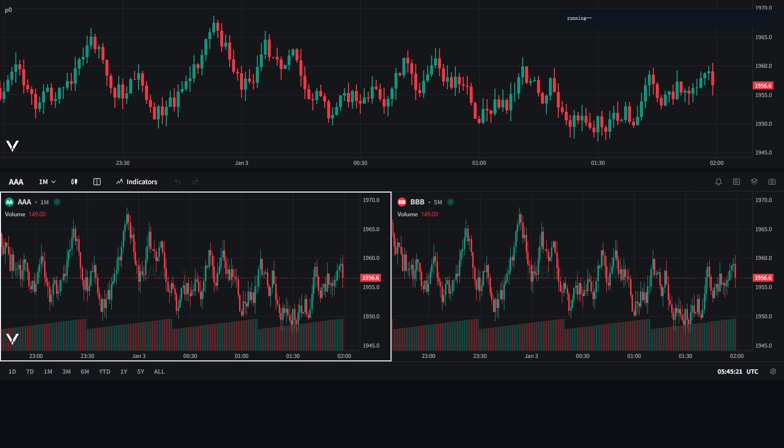

# P0 验证记录：Vela 0.9.3 + vela-pinets

环境：`@luxalgo/vela@0.9.3`、`@luxalgo/vela-pinets`（含 pine 运行时）、esbuild 打包（2.21 MB 未压缩），静态页 `127.0.0.1:8732`，Chromium 实测。数据为合成 3,000 根 1m（价格 ~2000）。



## 结论速览

| 项 | 结论 | 依据 |
|---|---|---|
| A 离线数据 | **可用** | `setMarket({ data, symbol, timeframe })` → `market.offline === true`，K 线正常绘制 |
| B 回放 | **可用且字段够用** | `replay.start/step/play(ms)/pause/stop`、`state`、`bounds`、`replay:*` 事件全部按声明工作 |
| C Pine（vela-pinets） | **能跑通，但第二次调用返回 ok:false** | 首个脚本 `ok:true`；同一图上再跑第二个脚本 `ok:false`（原因未捕获，见 §5） |
| D 工作区 | **可用**，`applyState` 往返正常 | `layout '2h'→'4'→'8'` 格子数 2→4→8；快照恢复后回到 8 格 |
| E 自绘坐标（R1 备用路） | **成立** | `registerRendererLayer` 的 `render(args)` 里 `args.coords` 有 `timeToX / priceToY / yToPrice / xToLogical / setBars` |

## 1. A · 离线数据

```js
await chart.setMarket({ symbol:'DEMO', timeframe:'1m', data: bars });
await chart.ready();
```

- `chart.market` → `{ offline:true, symbol:'DEMO', timeframe:'1m' }`
- `getVisibleRange()` → 默认只框住尾部 **180 分钟**（3000 根 1m 里最后 180 根）。**首屏默认窗口是 180 根左右**，我们要的是"看得见一段历史"，所以 P1 必须显式给 `visibleRange`（`MarketConfig.visibleRange` 支持 preset 或 `{from,to}`）。
- `chart.inspect()` 的键是 `['indicators','totals']`，**不是** `series/drawings/fills`（可行性文档里按类型名猜的那套不对），自检断言要按实际结构写。

## 2. B · 回放

`replay.start({ from })` 之后：

```json
{ "active": true, "playing": false, "cursorTime": 1767387600000,
  "remaining": 299, "nextTime": 1767387660000, "intervalMs": 1000 }
```

- `step()` 返回 `true`（还有下一根）/`false`（到头），**语义正好是我们回放条要的**。
- `play(120)` → `state.intervalMs = 120`；700 ms 内触发 4 次 `replay:step`（≈ 120 ms/次，符合预期）。
- `bounds` → `{ first, last }`（epoch ms），随机起点/进度条直接用它。
- `replay:end` 的 `reason` = `stopped`（也支持 `finished` / `market`）。
- **注意**：`intervalMs` 是"每次揭示一根"的间隔，我们的 0.25×–16× 需要一张映射表（例如 0.25× → 4000 ms，16× → 60 ms）。

## 3. C · Pine（vela-pinets）

```js
chart.registerEngine('pine', new PineEngine());
const r1 = await chart.runScript('//@version=6\nindicator("p0","p0",overlay=true)\nplot(close, color=color.yellow)', { id:'p0ind' });
// → ok:true；handle 出现在 chart.indicators() = [{id:'p0ind', visible:true}]
```

`run` 的字段：`id, title, kind, cause, first, bar, time, forming, complete, plots, vars, warnings, trades, series` —— **`warnings` 和 `trades` 直接给了我们原来要自己抽的东西**（策略回测统计可以少写一层）。

**问题**：同一图第二次 `runScript`（换 `id` 或换脚本）返回 `ok:false`，且 `error` 字段没被捕获到（我的探针只打了 `res.error`，实际可能在 `warnings`/异常里）。P4 开工前必须先把这个搞清：
- 是 `id` 重复（第一次用了 `p0ind`，第二次 `p0b`，应当不冲突）；
- 还是引擎不支持同图多脚本；
- 还是需要在 `market:changed` / `bars` 就绪后再跑。

→ 记为 **P4 前置实验 #1**。（**2026-11-05 已关闭**：`PineEngine` 连续两次 `execute` 实测均 `ok`，问题在 `chart.runScript` 的用法，不是引擎限制 —— 见 [VELA-PINETS-COVERAGE.md](VELA-PINETS-COVERAGE.md) 表 #2）

## 4. D · 工作区

```js
new VelaWorkspace('#c2', { layout:'2h', theme:'dark',
  cells: { a:{symbol:'AAA',timeframe:'1m',data:bars}, b:{symbol:'BBB',timeframe:'5m',data:bars} } })
```

- `cells()` → `['a','b']`；`setLayout('4')` → `['a','b','c1','c2']`；`setLayout('8')` → 8 格 ✓（**D3 决策可行**）
- 每格离线数据用 `cells[id].data` ✓（`CellSeed.data` 明确支持"replaces the provider (boot-only)"）
- `getState()` → `{ version, layout, timezone, sync, charts, activeCellId }`；`charts` 里每格有 `symbol/provider/timeframe/priceStyle/bars/session/watermark/indicatorTitles/indicatorValues/statuslineParts/rendererConfig/drawings/indicators`
- `applyState(snap)` 往返：8 格快照 → 切到 `2h` → `applyState` → 回到 8 格且 id 一致 ✓（**TAB 快照方案可行**）
- 内置顶栏显示 `AAA · 1M` / `BBB · 5M` 与成交量（见截图），我们的 `volTag`、格子品种标签要跟它对齐，别做两套。

## 5. E · 自绘坐标（R1 备用通路已证实）

```js
registerRendererLayer({ id:'p0probe', create: () => ({
  mount(canvas) {}, render(args) { /* args.coords.timeToX(...) */ } }) });
```

实测 `render(args)` 里 `args.coords` 方法齐全：`['timeToX','yToPrice','xToLogical','priceToY','setBars']`，`args.bars` 是当前视图的 OHLCV 数组。

- 结论：**即使将来要自己画任何东西（自定义指标 painter、Pine 之外的图形），通路是有的**，不必依赖 `vela-pinets`。
- 注意：首帧 `args.bars.length === 0`，要等 `bars` 事件或下一帧才拿到数据 —— 自绘层必须处理空数组。

## 6. 对迁移方案的影响

1. **P1 增加一项**：显式 `visibleRange`（默认 180 根太短，不符合"打开就看到一段历史"）。
2. **P4 增加前置实验**：同图多脚本 `runScript` 的 `ok:false` 问题（§3）。
3. **P2 简化**：`cells[id].data` 直接支持每格离线数据 → 自检与 DEMO 用它，不必为每个格子注册 provider。生产数据走 §8 的 `DataProvider`。
4. `inspect()` 结构与我们预想不同，自检断言按 `{indicators, totals}` 写。
5. 包体：esbuild 打包 vela+vela-pinets+workspace = **2.21 MB**（未压缩，min 后估算 ~1.3–1.5 MB），对比现状 klinecharts 240 KB + pinets 796 KB ≈ 1.04 MB，**净增约 0.3–0.5 MB**，本地自用可接受。

## 7. 复现方式

```bash
cd %LOCALAPPDATA%\Temp\vela-spike
npm i @luxalgo/vela @luxalgo/vela-pinets esbuild
npx esbuild p0.js --bundle --format=esm --minify --outfile=p0.bundle.js
python -m http.server 8732 --bind 127.0.0.1
# 打开 http://127.0.0.1:8732/p0.html ，页面右上角打印 window.__P0__
```

## 8. P0-b · 自定义 `DataProvider`（模式 2）实测

问题：离线数组（模式 1）只在建图时吃一次整表，没有增量语义。Vela 还有两条路：

| 模式 | 入口 | 增量 | 适用 |
|---|---|---|---|
| 1 离线数组 | `setMarket({ data })` | 无（整表替换） | 自检、DEMO 数据 |
| 2 `DataProvider` | `chart.data.registerProvider('name', p)` + `setMarket({ provider:'name' })` | **有**：每次按 `{from, to, limit}` 取数；`loadRange` 专拉尾部未缓存段 | **我们的 IndexedDB 分块存储** |
| 3 `MarketDataFeed`（底层） | 自定义 feed：`load / loadProgressive / subscribe(onBar) / loadRange` | `subscribe(cfg, onBar)` 可推进**实时** forming bar | 将来接实时行情 |

**实跑（200,000 根 1m，provider 返回内存数组）**：

```
providers: ['memtest']
getBars('MEM1','1m',{limit:5000}) → 5000 根，调用 1 次
首屏 35 ms · historyComplete() 0 ms · 总耗时 4.2 s（含后续 setVisibleRange 与回放）
heap 41 MB · market.offline = false · market.symbol = 'MEM1'
回放：replay.start({from}) 正常，state.remaining=499，step() → true
```

- **Provider 模式下回放同样可用**，不需要为回放另写逻辑。
- 默认可见窗口仍是 **180 根**（两种模式一致）。
- ⚠️ **深度回填未验证**：把视口移到 20 万根之前时**没有触发第二次取数**（`calls` 一直是 1）。说明给 `limit` 时 Vela 认为这就是全部历史；真正的"往左翻拉更多"要么给 `from/to`、要么实现 `getBarsProgressive`。→ **P1 必须验证**（这决定 4M 根数据是"一次拉 5000 + 按需回填"还是"整段进内存"）。

## 9. 数据模式决策（P1 前置）

**采用模式 2（自定义 `DataProvider`）**，理由：

1. 我们的数据本来就在 IndexedDB 的 `chunks` 里按块存（28 B/根），`getBars(range)` 正好用现成的 `binread.js` 按需读，不必把 4M 根一次性解到内存；
2. `loadRange` 语义 = "只拉未缓存的尾部" = 我们现在的「下载追加」；
3. `subscribe(onBar)` 给未来接实时行情留了口子；
4. 离线数组（模式 1）保留，只用于 `?selftest` 与 DEMO 数据——自检不该依赖 IndexedDB。

代价：多写 `vela-data.js`（`getBars` / `listSymbols` / `getSymbolInfo` 三个方法 + 复用它现有的分块读取），约 **150 行、+0.5 人日**（P1 从 3 → 3.5 人日，总 21 → 21.5）。

## 10. P0-c · 400 万根分块 provider：回填到底怎么走（决定性实测）

数据源：4,000,000 根 1m **按索引程序化生成**（不预存，`barAt(i)` 现算），provider 按 `{from,to,limit}` 切片返回。

| 场景 | provider 被调用的形态 | 内存 | 备注 |
|---|---|---|---|
| `setMarket({ bars: 5000 })` | **1 次**：`getBars({ limit:5000 })` | 42 MB | 首屏 40 ms |
| 视口移到 2016 年 + `panBy(-0.9)` ×6 | **0 次新调用**（仍是 1） | 42 MB | **往左翻不会自动回填** |
| `setMarket({ bars: 1_000_000 })` | **101 次**：`{to: t, limit: 10001}` 逐页向前 | 363 MB | 首屏 4 ms（异步回填） |
| `getBarsProgressive` 返回全部 4M | 1 次：`{ limit:200000 }` | **1,081 MB** | 全量入内存 = 1 GB，**不能这么干** |

### 三条硬结论

1. **`bars` = 回放窗口深度**，Vela 会以 **10,001 根/页** 向前翻页补到指定深度；400 万根 = 1 GB 堆，**绝不能让 4M 全进内存**。
2. **往左拖动不会触发再取数**。想要更早的历史只有两条路：`setMarket({ bars: 更大 })` 重建，或 `setMarket({ visibleRange:{from,to} })` 指定窗口。→ 我们现有的「设为起点 / 随机起点 / 日期定位」本来就要重灌一次窗口，正好对上，**40 ms 的开销可接受**。
3. **`getBarsProgressive` 可用**：Vela 会用 `{limit}` 调它，允许边下边画（先给尾部 2000 根，再补历史）。

### 落到方案上的调整（覆盖 §9 的早期说法）

- **`vela-data.js` 的 `getBars` 实现**：按 `{from,to,limit}` 从 IndexedDB 分块切片返回，**永不返回整段**；`limit` 缺省时按 `min(请求区间, 20_000)` 截断自保。
- **回放深度策略**：`bars` 用 **8,000–20,000**（堆 2–8 MB）；设定起点/随机起点 → `setMarket({ bars, visibleRange })` 重建，实测 40 ms 级。
- **P1 验收判据改成可量化的**：设 5000 根 → 首屏 ≤ 150 ms、堆 ≤ 60 MB；设 20000 根 → 堆 ≤ 120 MB；跳到任意日期 ≤ 300 ms；全程无 101 次翻页式的隐藏开销（因为深度小）。
- **P2/P4 注意**：每个格子各自一份 `bars` 深度，8 格 × 20,000 根 × 0.36 KB ≈ 58 MB，可接受；但**别在 8 格里都用 100 万深度**。

### 复现

```bash
npx esbuild p0c.js --bundle --format=esm --minify --outfile=p0c.bundle.js
python -m http.server 8732 --bind 127.0.0.1   # 打开 /p0c.html，看 window.__P0C__
```
